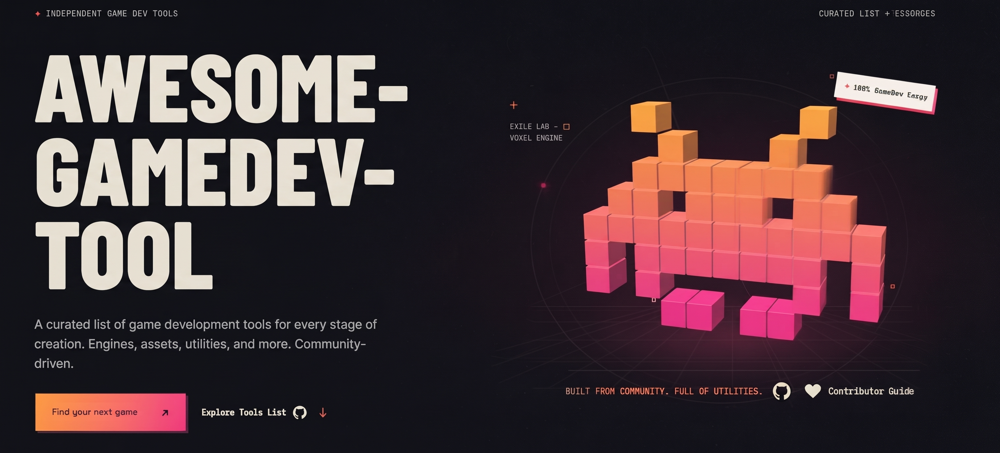

<div align="center">

<a href="https://github.com/GameDev-Toolkit/awesome-GameDev-tool">
  
</a>


[](https://awesome.re)
[](CONTRIBUTING.md)
[](LICENSE)
[](https://github.com/GameDev-Toolkit/awesome-GameDev-tool/actions/workflows/link-check.yml)

**Every tool you need to make a game — from the first prototype to the store page.**

<sub>A curated, link-checked, community-driven index of engines, art tools, audio software, middleware and everything in between.</sub>


</div>

> **TL;DR** — 24 categories, 1,000+ hand-picked tools, every link verified by CI. Found something missing or dead? [Open a PR](CONTRIBUTING.md) — it takes two minutes.

## Contents

- [Start Here](#start-here)
- [Legend](#legend)
- [1. Game Engines](#1-game-engines)
- [2. Frameworks and Libraries](#2-frameworks-and-libraries)
- [3. 2D Art and Pixel Art](#3-2d-art-and-pixel-art)
- [4. 3D Art and Modeling](#4-3d-art-and-modeling)
- [5. VFX, Shaders and Rendering](#5-vfx-shaders-and-rendering)
- [6. Level Design and World Building](#6-level-design-and-world-building)
- [7. Audio and Music](#7-audio-and-music)
- [8. Assets, Textures and Icons](#8-assets-textures-and-icons)
- [9. Animation, Cinematics and Video](#9-animation-cinematics-and-video)
- [10. Narrative, Dialogue and Writing](#10-narrative-dialogue-and-writing)
- [11. Game Design and Prototyping](#11-game-design-and-prototyping)
- [12. Fantasy Consoles and Retro Dev](#12-fantasy-consoles-and-retro-dev)
- [13. AI and Procedural Generation](#13-ai-and-procedural-generation)
- [14. Multiplayer, Networking and Backend](#14-multiplayer-networking-and-backend)
- [15. Analytics, LiveOps and Monetization](#15-analytics-liveops-and-monetization)
- [16. Publishing, Stores and Marketing](#16-publishing-stores-and-marketing)
- [17. QA, Debugging and Profiling](#17-qa-debugging-and-profiling)
- [18. Build, CI/CD and Version Control](#18-build-cicd-and-version-control)
- [19. Programming Tools and IDEs](#19-programming-tools-and-ides)
- [20. Core Libraries, Physics and Math](#20-core-libraries-physics-and-math)
- [21. Localization and Accessibility](#21-localization-and-accessibility)
- [22. Learning and Documentation](#22-learning-and-documentation)
- [23. Communities, News and Game Jams](#23-communities-news-and-game-jams)
- [24. Everyday Utilities](#24-everyday-utilities)
- [Contributing](#contributing)
- [Link health](#link-health)
- [License](#license)

## Start Here

New to this list (or to gamedev)? Pick your path — everything is linked in the full sections below.

| I want to… | Start with |
| :-- | :-- |
| Make my first 2D game | [Godot](https://godotengine.org) · [GameMaker](https://gamemaker.io) · [LÖVE](https://love2d.org) |
| Make a 3D game | [Unreal Engine](https://www.unrealengine.com) · [Unity](https://unity.com) · [Godot](https://godotengine.org) |
| Ship a browser game | [Phaser](https://phaser.io) · [PixiJS](https://pixijs.com) · [PlayCanvas](https://playcanvas.com) |
| Draw pixel art | [Aseprite](https://www.aseprite.org) · [LibreSprite](https://libresprite.github.io) · [Pixelorama](https://github.com/Orama-Interactive/Pixelorama) |
| Get free art and audio | [Kenney](https://kenney.nl) · [OpenGameArt](https://opengameart.org) · [Freesound](https://freesound.org) |
| Design levels | [Tiled](https://www.mapeditor.org) · [LDtk](https://ldtk.io) · [TrenchBroom](https://trenchbroom.github.io) |
| Write dialogue and story | [Twine](https://twinery.org) · [Ink](https://www.inklestudios.com/ink/) · [Yarn Spinner](https://yarnspinner.dev) |
| Add sound effects | [jsfxr](https://sfxr.me) · [ChipTone](https://sfbgames.itch.io/chiptone) · [FMOD](https://www.fmod.com) |
| Find bugs and slow frames | [RenderDoc](https://renderdoc.org) · [Tracy](https://github.com/wolfpld/tracy) · [Sentry](https://sentry.io) |
| Publish and sell it | [Steamworks](https://partner.steamgames.com) · [itch.io](https://itch.io) · [How To Market A Game](https://howtomarketagame.com) |

## Legend

| Tag | Meaning |
| :-- | :-- |
| `OSS` | Open source — the code is available and you can build it yourself |
| `FREE` | Free to use, source not published |
| `FREEMIUM` | Free tier or free version, paid upgrades / royalties / pro plans |
| `PAID` | One-time purchase or subscription |
| `WEB` | Runs in the browser, nothing to install |
| `AI` | Uses generative AI |

> Prices and licenses change. Every entry here was correct when it was added — if something moved, please [send a PR](CONTRIBUTING.md).


## 1. Game Engines

> The thing that turns your ideas into a running game. Pick one, learn it deeply, ship something.

### 1.1 General Purpose

- **[Adventure Game Studio](https://www.adventuregamestudio.co.uk)** – The classic point-and-click adventure engine, still going strong. `OSS` `FREE`
- **[AppGameKit](https://www.appgamekit.com)** – Cross-platform BASIC and C++ engine with quick device deploys. `PAID`
- **[Armory](https://armory3d.org)** – Blender-integrated engine that exports full games from Blender's node system. `OSS` `FREE`
- **[Bevy](https://bevyengine.org)** – Data-driven Rust engine built on the ECS pattern; very active community. `OSS` `FREE`
- **[Buildbox](https://buildbox.com)** – Drag-and-drop engine aimed at hyper-casual mobile games. `PAID`
- **[Cerberus X](https://github.com/PhilMoe/cerberus)** – Open-source cross-platform BASIC-like language and 2D engine (successor of Monkey X). `OSS` `FREE`
- **[Cocos Creator](https://www.cocos.com/en/creator)** – Open-source engine specialised in 2D/3D mobile and mini-games. `OSS` `FREE`
- **[Construct 3](https://www.construct.net)** – No-code event-sheet engine that runs entirely in the browser. `FREEMIUM` `WEB`
- **[CopperCube](https://www.ambiera.com/coppercube/)** – Simple 3D engine for quickly building walkthroughs and small games, no code required. `FREEMIUM`
- **[CryEngine](https://www.cryengine.com)** – The engine behind Crysis; pay-what-you-want licensing for indies. `FREEMIUM`
- **[ct.js](https://ctjs.rocks)** – Free 2D engine with a friendly IDE and JavaScript/TypeScript scripting. `OSS` `FREE`
- **[Defold](https://defold.com)** – Free, tiny, battle-tested 2D/3D engine from the King team, written in Lua. `FREE`
- **[Flax Engine](https://flaxengine.com)** – Modern C#/C++ engine with source access and a friendly editor. `FREE`
- **[Fyrox](https://fyrox.rs)** – Rust game engine with a full scene editor and 3D/2D support. `OSS` `FREE`
- **[GameMaker](https://gamemaker.io)** – Fast 2D engine with GML and drag-and-drop; a favourite for pixel-art games. `FREEMIUM`
- **[GameSalad](https://gamesalad.com)** – Visual, no-code engine for 2D mobile games. `PAID`
- **[GDevelop](https://gdevelop.io)** – Open-source no-code engine with a huge library of ready-made behaviours. `OSS` `FREE`
- **[Godot Engine](https://godotengine.org)** – Fully free 2D/3D engine with GDScript, C#, C++ bindings and a tiny download. `OSS` `FREE`
- **[microStudio](https://microstudio.dev)** – Browser-based engine supporting several languages, perfect for jams and teaching. `FREEMIUM` `WEB`
- **[O3DE](https://o3de.org)** – Open 3D engine (the continuation of Amazon Lumberyard) backed by the Linux Foundation. `OSS` `FREE`
- **[Roblox Studio](https://create.roblox.com)** – Build and publish multiplayer 3D experiences to the Roblox platform in Lua. `FREE`
- **[RPG Maker](https://www.rpgmakerweb.com)** – Long-running series for 2D role-playing games with a huge plugin scene. `PAID`
- **[Solar2D](https://solar2d.com)** – Lua-based 2D engine (formerly Corona SDK) with instant device previews. `OSS` `FREE`
- **[Stride](https://www.stride3d.net)** – Open-source C# engine with a modern renderer, formerly Xenko. `OSS` `FREE`
- **[Torque3D](https://torque3d.org)** – Long-lived open-source 3D engine with a small but loyal community. `OSS` `FREE`
- **[Unity](https://unity.com)** – The most widely used engine for indie and mobile; huge asset ecosystem and C# scripting. `FREEMIUM`
- **[Unreal Engine](https://www.unrealengine.com)** – AAA-grade renderer and Blueprints visual scripting; royalty-based licensing. `FREEMIUM`
- **[Urho3D](https://urho3d.github.io)** – Lightweight C++ 2D/3D engine with a clean API and many language bindings. `OSS` `FREE`
- **[Visionaire Studio](https://www.visionaire-studio.net)** – Adventure-game engine with a visual scripting front end. `FREEMIUM`
- **[Wick Editor](https://www.wickeditor.com)** – Free browser toolkit for games, animation and interactive media. `OSS` `WEB`

### 1.2 Web and HTML5

- **[A-Frame](https://aframe.io)** – Declarative HTML-based framework for WebXR and 3D scenes. `OSS` `FREE` `WEB`
- **[Babylon.js](https://www.babylonjs.com)** – Full 3D engine for the web with an editor, PBR, physics and XR support. `OSS` `FREE` `WEB`
- **[Excalibur](https://excaliburjs.com)** – TypeScript 2D engine with a clean scene/actor model. `OSS` `FREE` `WEB`
- **[Heaps](https://heaps.io)** – High-performance Haxe engine used by many commercial web and mobile games. `OSS` `FREE`
- **[Impact](https://impactjs.com)** – Classic commercial JS engine, still a great read for architecture ideas. `PAID`
- **[Kaplay](https://kaplayjs.com)** – Friendly JS game library (successor of Kaboom.js) with a playful API. `OSS` `FREE` `WEB`
- **[Kha](https://kha.tech)** – Haxe framework compiling to WebGL, Vulkan, Metal, Direct3D and consoles. `OSS` `FREE`
- **[melonJS](https://melonjs.org)** – Lightweight 2D engine with a built-in Tiled map loader. `OSS` `FREE` `WEB`
- **[OpenFL](https://www.openfl.org)** – Flash-like API that compiles to HTML5, native, iOS and Android. `OSS` `FREE`
- **[p5.js](https://p5js.org)** – Creative-coding library, excellent for prototypes, jams and generative art. `OSS` `FREE` `WEB`
- **[Phaser](https://phaser.io)** – Batteries-included 2D HTML5 game framework with a massive tutorial base. `OSS` `FREE` `WEB`
- **[PixiJS](https://pixijs.com)** – The fastest 2D WebGL/Canvas renderer; a foundation rather than a full engine. `OSS` `FREE` `WEB`
- **[PlayCanvas](https://playcanvas.com)** – Cloud 3D editor plus runtime, ideal for teams collaborating in a browser. `FREEMIUM` `WEB`
- **[react-three-fiber](https://github.com/pmndrs/react-three-fiber)** – React renderer for Three.js; great for UI-heavy 3D games. `OSS` `FREE` `WEB`
- **[Three.js](https://threejs.org)** – The de-facto WebGL/WebGPU 3D library; thousands of examples to learn from. `OSS` `FREE` `WEB`

### 1.3 Text, Interactive Fiction and Visual Novels

- **[Adventuron](https://adventuron.io)** – Browser-based authoring system for 8-bit style text adventures. `FREEMIUM` `WEB`
- **[Arcweave](https://arcweave.com)** – Collaborative narrative design tool that exports to engines. `FREEMIUM`
- **[articy:draft](https://www.articy.com)** – Industry-standard narrative authoring suite with flow and entity management. `PAID`
- **[Chat Mapper](https://www.chatmapper.com)** – Dialogue database tool with a simulator and many export formats. `FREEMIUM`
- **[ChoiceScript](https://www.choiceofgames.com/make-your-own-games/choicescript-intro/)** – Simple scripting language for choice-based fiction from Choice of Games. `FREE`
- **[Dialogic](https://github.com/dialogic-godot/dialogic)** – Visual dialogue and timeline editor for Godot. `OSS` `FREE`
- **[Fungus](https://github.com/snozbot/fungus)** – Free, mature narrative toolkit for Unity with flowchart authoring. `OSS` `FREE`
- **[Inform 7](https://ganelson.github.io/inform-website/)** – Natural-language parser for interactive fiction, with a huge back catalogue. `FREE`
- **[Ink](https://www.inklestudios.com/ink/)** – Narrative scripting language by Inkle, with exporters for Unity, Godot and the web. `OSS` `FREE`
- **[Inky](https://github.com/inkle/inky)** – The official editor for Ink, with live story previews. `OSS` `FREE`
- **[Naninovel](https://naninovel.com)** – Full-featured visual-novel framework for Unity with a polished editor. `PAID`
- **[Quest](https://textadventures.co.uk/quest)** – Free text-adventure creator with a visual editor and web player. `FREEMIUM` `WEB`
- **[Ren'Py](https://www.renpy.org)** – The most popular visual-novel engine, with Python scripting under the hood. `OSS` `FREE`
- **[Twine](https://twinery.org)** – Open-source tool for branching, hypertext-driven stories; runs in your browser. `OSS` `FREE` `WEB`
- **[Yarn Spinner](https://yarnspinner.dev)** – Dialogue system for Unity (and C#) with a friendly writer-facing syntax. `OSS` `FREE`


## 2. Frameworks and Libraries

> Don't need a full editor? These give you a window, a game loop and input — you bring the rest.

### 2.1 C and C++

- **[Allegro](https://liballeg.org)** – Classic game programming library with a long history and simple C API. `OSS` `FREE`
- **[bgfx](https://bkaradzic.github.io/bgfx/)** – Cross-platform rendering library with many backends and a shader compiler. `OSS` `FREE`
- **[Diligent Engine](https://github.com/DiligentGraphics/DiligentEngine)** – Cross-platform low-level graphics framework supporting D3D11/12, Vulkan, Metal and WebGPU. `OSS` `FREE`
- **[EnTT](https://github.com/skypjack/entt)** – Header-only entity-component-system library used in many commercial engines. `OSS` `FREE`
- **[Filament](https://github.com/google/filament)** – Google's real-time PBR renderer for mobile and desktop. `OSS` `FREE`
- **[flecs](https://github.com/SanderMertens/flecs)** – Fast, feature-rich ECS with prefabs, relationships and a query language. `OSS` `FREE`
- **[GLFW](https://www.glfw.org)** – Tiny library for creating windows, OpenGL contexts and handling input. `OSS` `FREE`
- **[Irrlicht](https://irrlicht.sourceforge.io)** – Compact 3D engine with a simple C++ API and software/OpenGL/D3D drivers. `OSS` `FREE`
- **[Magnum](https://magnum.graphics)** – Modern C++11 graphics engine with a focus on clean APIs. `OSS` `FREE`
- **[NanoVG](https://github.com/memononen/nanovg)** – Antialiased 2D vector drawing library on top of OpenGL. `OSS` `FREE`
- **[Ogre3D](https://www.ogre3d.org)** – Veteran open-source 3D rendering engine with a scene-graph API. `OSS` `FREE`
- **[openFrameworks](https://openframeworks.cc)** – C++ creative-coding toolkit with a friendly, art-first community. `OSS` `FREE`
- **[raylib](https://www.raylib.com)** – Minimal, delightful C library for learning and prototyping; bindings for 60+ languages. `OSS` `FREE`
- **[SDL3](https://github.com/libsdl-org/SDL)** – The cross-platform window, input, audio and GPU access layer behind thousands of games. `OSS` `FREE`
- **[SFML](https://www.sfml-dev.org)** – Friendly C++ multimedia library with graphics, audio, network and window modules. `OSS` `FREE`
- **[sokol](https://github.com/floooh/sokol)** – Single-header C libraries for graphics, audio, app and time — perfect for small native games. `OSS` `FREE`

### 2.2 C# and .NET

- **[FNA](https://fna-xna.github.io)** – Accurate XNA4 reimplementation, the backbone of many commercial ports. `OSS` `FREE`
- **[Foster](https://github.com/FosterFramework/Foster)** – Small, friendly 2D C# framework built on MonoGame. `OSS` `FREE`
- **[MonoGame](https://www.monogame.net)** – The open-source continuation of XNA; runs on desktop, mobile and consoles. `OSS` `FREE`
- **[Nez](https://github.com/prime31/Nez)** – Feature-packed 2D framework for MonoGame with ECS, physics and UI. `OSS` `FREE`
- **[OpenTK](https://opentk.net)** – OpenGL, OpenAL and input bindings for .NET with a small game window helper. `OSS` `FREE`
- **[Silk.NET](https://dotnet.github.io/Silk.NET/)** – Modern .NET bindings for OpenGL, Vulkan, OpenAL, SDL and more. `OSS` `FREE`
- **[Veldrid](https://github.com/veldrid/veldrid)** – Low-level, portable .NET graphics API abstraction. `OSS` `FREE`

### 2.3 Rust

- **[bracket-lib](https://github.com/amethyst/bracket-lib)** – Roguelike-focused toolkit with terminals, pathfinding and utilities. `OSS` `FREE`
- **[ggez](https://ggez.rs)** – Lightweight 2D framework inspired by LÖVE. `OSS` `FREE`
- **[Macroquad](https://macroquad.rs)** – Simple, fast 2D/3D framework with instant compile times and WASM support. `OSS` `FREE`
- **[Piston](https://www.piston.rs)** – Modular game engine ecosystem of small, composable crates. `OSS` `FREE`

### 2.4 Lua, Python and Haxe

- **[Arcade](https://api.arcade.academy)** – Modern Python 2D library with OpenGL rendering and a beginner-friendly API. `OSS` `FREE`
- **[HaxeFlixel](https://haxeflixel.com)** – 2D engine with a rich standard library and web/native targets. `OSS` `FREE`
- **[Kivy](https://kivy.org)** – Cross-platform Python UI and game framework for desktop and mobile. `OSS` `FREE`
- **[KorGE](https://korge.org)** – Kotlin Multiplatform 2D game engine with a modern coroutine-based API. `OSS` `FREE`
- **[LÖVE](https://love2d.org)** – Delightfully simple 2D framework in Lua; the classic jam weapon. `OSS` `FREE`
- **[Panda3D](https://www.panda3d.org)** – Full 3D engine in Python and C++ with a long commercial history. `OSS` `FREE`
- **[pygame-ce](https://pyga.me)** – Community edition of Pygame with performance fixes and active maintenance. `OSS` `FREE`
- **[Pygame](https://github.com/pygame/pygame)** – The classic Python game library and a rite of passage for new programmers. `OSS` `FREE`
- **[pyglet](https://pyglet.org)** – Pure-Python windowing and multimedia library with no external dependencies. `OSS` `FREE`

### 2.5 Java, Go, Dart and friends

- **[Bonfire](https://bonfire-engine.github.io)** – RPG-focused framework built on top of Flame. `OSS` `FREE`
- **[Ebitengine](https://ebitengine.org)** – Minimal 2D engine for Go with a single-import API. `OSS` `FREE`
- **[Flame](https://flame-engine.org)** – The game engine for Flutter — write once, run on mobile, web and desktop. `OSS` `FREE`
- **[jMonkeyEngine](https://jmonkeyengine.org)** – Open-source 3D Java engine with a scene graph and SDK. `OSS` `FREE`
- **[libGDX](https://libgdx.com)** – Powerful Java/Kotlin framework for desktop, Android, iOS and web. `OSS` `FREE`
- **[LWJGL](https://www.lwjgl.org)** – Low-level Java bindings to OpenGL, Vulkan, OpenAL and GLFW. `OSS` `FREE`
- **[Oak](https://github.com/oakmound/oak)** – Go game engine with a scene stack and event system. `OSS` `FREE`


## 3. 2D Art and Pixel Art

> Sprites, tiles, portraits, UI. Half of game development happens in these tools.

### 3.1 Pixel Art Editors

- **[Aseprite](https://www.aseprite.org)** – The industry favourite: layers, onion skin, tags, tilesets and a powerful CLI. `PAID` `OSS`
- **[GrafX2](https://gitlab.com/GrafX2/grafx2)** – Free pixel-painting program inspired by Deluxe Paint. `OSS` `FREE`
- **[GraphicsGale](https://graphicsgale.com/us/)** – Long-standing pixel and animation editor, now freeware. `FREE`
- **[Hexels](https://marmoset.co/hexels/)** – Grid-based vector art tool for isometric and hexagonal pixel styles. `PAID`
- **[LibreSprite](https://libresprite.github.io)** – Free fork of the last open-source Aseprite, actively maintained. `OSS` `FREE`
- **[Piskel](https://www.piskelapp.com)** – Dead-simple browser pixel editor and sprite animator. `OSS` `FREE` `WEB`
- **[Pixel Composer](https://github.com/Ttanasart-pt/Pixel-Composer)** – Node-based procedural tool for generating and animating pixel art. `OSS` `FREE`
- **[Pixelorama](https://github.com/Orama-Interactive/Pixelorama)** – Free, cross-platform pixel editor with animation and infinite canvas. `OSS` `FREE`
- **[PixelOver](https://pixelover.io)** – Turn 3D renders, videos and high-res art into animated pixel art. `PAID`
- **[Pro Motion NG](https://www.cosmigo.com/)** – Deep pixel-art tool with advanced dithering, shading and tile tools. `PAID`
- **[Pyxel Edit](https://pyxeledit.com)** – Pixel editor with excellent tile and animation workflows. `PAID`
- **[Sprite Fusion](https://www.spritefusion.com)** – Free browser tilemap and sprite-sheet editor with a Tiled exporter. `FREEMIUM` `WEB`
- **[Tilesetter](https://www.tilesetter.org)** – Generate complete tilesets and autotiles from a few hand-drawn pieces. `PAID`

### 3.2 Digital Painting and Illustration

- **[Adobe Photoshop](https://www.adobe.com/products/photoshop.html)** – Industry standard for raster editing, concepts and texture work. `PAID`
- **[Affinity Photo](https://affinity.serif.com/photo/)** – One-time-purchase professional photo editor. `PAID`
- **[Clip Studio Paint](https://www.clipstudio.net)** – Illustrator and manga favourite with superb line and tone tools. `PAID`
- **[FireAlpaca](https://firealpaca.com)** – Lightweight free painting app popular for comic and sprite work. `FREE`
- **[GIMP](https://www.gimp.org)** – The classic open-source image editor and retoucher. `OSS` `FREE`
- **[Krita](https://krita.org)** – Free professional painting studio with excellent brush engines and animation. `OSS` `FREE`
- **[MediBang Paint](https://medibangpaint.com)** – Free cloud-based painting app with cross-device sync. `FREE`
- **[MyPaint](https://mypaint.app)** – Distraction-free painting program with an infinite canvas. `OSS` `FREE`
- **[Paint.NET](https://www.getpaint.net)** – Surprisingly capable free Windows editor for quick texture jobs. `FREE`
- **[Photopea](https://www.photopea.com)** – PSD-compatible editor that runs entirely in the browser, free. `FREEMIUM` `WEB`
- **[Procreate](https://procreate.com)** – Beloved iPad painting app used by countless concept artists. `PAID`
- **[Rebelle](https://www.escapemotions.com/products/rebelle/)** – Painting software that simulates real watercolour and ink physics. `PAID`

### 3.3 Vector, UI and Icon Design

- **[Adobe Illustrator](https://www.adobe.com/products/illustrator.html)** – The standard for vector art, logos and UI assets. `PAID`
- **[Affinity Designer](https://affinity.serif.com/designer/)** – Professional vector and raster design in one app, no subscription. `PAID`
- **[Boxy SVG](https://boxy-svg.com)** – Clean SVG editor that runs in the browser or as a desktop app. `FREEMIUM` `WEB`
- **[Figma](https://www.figma.com)** – Collaborative UI/UX design; great for HUDs, menus and design docs. `FREEMIUM` `WEB`
- **[Graphite](https://graphite.rs)** – Open-source 2D vector and raster editor built in Rust. `OSS` `FREE` `WEB`
- **[Inkscape](https://inkscape.org)** – Full-featured open-source SVG editor. `OSS` `FREE`
- **[Penpot](https://penpot.app)** – Open-source design and prototyping platform, self-hostable. `OSS` `FREE` `WEB`
- **[SVG-Edit](https://github.com/SVG-Edit/svgedit)** – Fast, dependency-free browser SVG editor you can embed in tools. `OSS` `FREE` `WEB`
- **[Vectr](https://vectr.com)** – Free, simple vector editor for quick icons and UI pieces. `FREE` `WEB`

### 3.4 Sprite Animation and Skeletal Tools

- **[Adobe Animate](https://www.adobe.com/products/animate.html)** – Flash successor for interactive 2D animation and games. `PAID`
- **[Cartoon Animator](https://www.reallusion.com/cartoon-animator/)** – Quick 2D character animation with motion libraries. `PAID`
- **[Creature](https://creature.kestrelmoon.com)** – Animation tool with procedural and mesh-based deformation. `PAID`
- **[DragonBones](https://dragonbones.github.io)** – Free 2D skeletal animation with an editor and open runtimes. `OSS` `FREE`
- **[Live2D Cubism](https://www.live2d.com/en/cubism/)** – Layered 2D character animation used in visual novels and VTuber rigs. `FREEMIUM`
- **[Moho](https://moho.lostmarble.com)** – 2D rigging and animation suite with powerful bone and physics tools. `PAID`
- **[OpenToonz](https://opentoonz.github.io)** – Professional 2D animation suite used by Studio Ghibli. `OSS` `FREE`
- **[Pencil2D](https://www.pencil2d.org)** – Simple hand-drawn animation for frame-by-frame work. `OSS` `FREE`
- **[Rive](https://rive.app)** – Interactive, state-machine-driven vector animation for games and apps. `FREEMIUM` `WEB`
- **[Spine](https://esotericsoftware.com)** – The standard 2D skeletal animation tool, with runtimes for every engine. `PAID`
- **[Spriter](https://brashmonkey.com)** – Affordable cutout animation tool with a gentle learning curve. `PAID`
- **[Synfig Studio](https://www.synfig.org)** – Vector-based 2D animation with a tweening workflow. `OSS` `FREE`
- **[Toon Boom Harmony](https://www.toonboom.com/products/harmony)** – Studio-grade 2D animation pipeline. `PAID`

### 3.5 Sprite Sheets and Texture Atlases

- **[Free Texture Packer](https://free-tex-packer.com)** – Free, open-source atlas packer with a web app and CLI. `OSS` `FREE` `WEB`
- **[Leshy SpriteSheet Tool](https://www.leshylabs.com/apps/sstool/)** – Browser tool for packing and slicing sprite sheets. `FREE` `WEB`
- **[LibGDX TexturePacker](https://libgdx.com/wiki/tools/texture-packer)** – Built-in atlas packer with nine-patch and whitespace stripping. `OSS` `FREE`
- **[ShoeBox](https://renderhjs.net/shoebox/)** – Adobe AIR utility for extracting, packing and slicing sprites. `FREE`
- **[SpriteIlluminator](https://www.codeandweb.com/spriteilluminator)** – Generate normal maps for 2D sprites to light them dynamically. `PAID`
- **[spritesmith](https://github.com/twolfson/spritesmith)** – Node.js sprite-sheet generator for build pipelines. `OSS` `FREE`
- **[TexturePacker](https://www.codeandweb.com/texturepacker)** – The reference sprite-atlas tool with exporters for every engine. `PAID`

### 3.6 Palettes, Colour and Contrast

- **[Adobe Color](https://color.adobe.com)** – Colour-wheel based palettes plus trend and accessibility tools. `FREE` `WEB`
- **[Coblis](https://www.color-blindness.com/coblis-color-blindness-simulator/)** – Simulate colour-blindness to check your readability. `FREE` `WEB`
- **[ColorBox](https://colorbox.io)** – Create colour scales and accessible gradients by curve. `FREE` `WEB`
- **[Color Hunt](https://colorhunt.co)** – Hand-picked four-colour palettes for UI and art. `FREE` `WEB`
- **[Colormind](http://colormind.io)** – Machine-learning palette generator that can lock colours you like. `FREE` `WEB`
- **[Coolors](https://coolors.co)** – Fast palette generator with contrast and accessibility checks. `FREEMIUM` `WEB`
- **[Image Color Picker](https://imagecolorpicker.com)** – Pull hex values straight out of a reference image. `FREE` `WEB`
- **[Lospec](https://lospec.com)** – The pixel-art hub: thousands of palettes, tutorials and a palette editor. `FREE` `WEB`
- **[Paletton](https://paletton.com)** – Classic colour-scheme designer built around colour theory. `FREE` `WEB`
- **[Picular](https://picular.co)** – Search colours by keyword for quick mood palettes. `FREE` `WEB`
- **[WebAIM Contrast Checker](https://webaim.org/resources/contrastchecker/)** – Verify text and UI contrast ratios against WCAG. `FREE` `WEB`

### 3.7 Image Optimisation and Conversion

- **[Basis Universal](https://github.com/BinomialLLC/basis_universal)** – Supercompressed GPU textures that transcode at runtime. `OSS` `FREE`
- **[CloudConvert](https://cloudconvert.com)** – Converts almost any asset format, with an API for automation. `FREEMIUM` `WEB`
- **[Compressonator](https://gpuopen.com/compressonator/)** – AMD's texture compression and analysis suite (BCn, ASTC, ETC). `OSS` `FREE`
- **[crunch](https://github.com/richgel999/crunch)** – Advanced lossy texture compression for DXT/ETC. `OSS` `FREE`
- **[ezgif](https://ezgif.com)** – Browser toolkit for GIF, APNG and WebP conversion and trimming. `FREE` `WEB`
- **[gifsicle](https://www.lcdf.org/gifsicle/)** – Command-line GIF optimiser and manipulator. `OSS` `FREE`
- **[GraphicsMagick](http://www.graphicsmagick.org)** – Lighter, faster ImageMagick fork favoured for batch jobs. `OSS` `FREE`
- **[ImageMagick](https://imagemagick.org)** – The Swiss army knife for batch conversion, resizing and compositing. `OSS` `FREE`
- **[ImageOptim](https://imageoptim.com)** – One-drop Mac app that runs several lossless optimisers for you. `OSS` `FREE`
- **[KTX-Software](https://github.com/KhronosGroup/KTX-Software)** – Khronos tools and library for KTX2 texture containers. `OSS` `FREE`
- **[libvips](https://www.libvips.org)** – Very fast demand-driven image processing library. `OSS` `FREE`
- **[oxipng](https://github.com/shssoichiro/oxipng)** – Fast, multithreaded lossless PNG optimiser for CI pipelines. `OSS` `FREE`
- **[pngquant](https://pngquant.org)** – Lossy PNG compressor that keeps alpha; huge wins on sprite sheets. `OSS` `FREE`
- **[sharp](https://sharp.pixelplumbing.com)** – Node.js image processing built on libvips; great for asset pipelines. `OSS` `FREE`
- **[Squoosh](https://squoosh.app)** – Google's browser-based image compressor with side-by-side preview. `OSS` `FREE` `WEB`
- **[SVGO](https://github.com/svg/svgo)** – Node-based SVG optimiser for build pipelines. `OSS` `FREE`
- **[SVGOMG](https://jakearchibald.github.io/svgomg/)** – Friendly web UI on top of SVGO with live preview. `OSS` `FREE` `WEB`
- **[TinyPNG](https://tinypng.com)** – Web service for shrinking PNG and JPEG files with smart quantisation. `FREEMIUM` `WEB`

### 3.8 Fonts and Typography

- **[Birdfont](https://birdfont.org)** – Friendly font editor for creating and editing glyphs. `OSS` `FREE`
- **[BMFont](https://www.angelcode.com/products/bmfont/)** – The classic bitmap-font generator for games. `FREE`
- **[Calligraphr](https://www.calligraphr.com)** – Turn your handwriting into a usable font. `FREEMIUM` `WEB`
- **[DaFont](https://www.dafont.com)** – Enormous archive of freeware and shareware fonts. `FREE` `WEB`
- **[FontForge](https://fontforge.org)** – Full-featured open-source font editor and converter. `OSS` `FREE`
- **[Fontsource](https://fontsource.org)** – Self-hostable open-source font packages for web and app builds. `OSS` `FREE` `WEB`
- **[Font Squirrel](https://www.fontsquirrel.com)** – Curated free fonts plus a webfont generator. `FREE` `WEB`
- **[Fontstruct](https://fontstruct.com)** – Build fonts out of geometric bricks in the browser. `FREE` `WEB`
- **[Glyphr Studio](https://www.glyphrstudio.com)** – Free browser-based font designer aimed at beginners. `OSS` `FREE` `WEB`
- **[Google Fonts](https://fonts.google.com)** – 1500+ open-licensed families, all free for commercial games. `FREE` `WEB`
- **[SnowB](https://www.snowb.org)** – Modern bitmap font builder with effects, shadows and outlines. `FREE`


## 4. 3D Art and Modeling

> Mesh, sculpt, texture, rig, export — the 3D pipeline outside the engine.

### 4.1 Modeling and Sculpting

- **[Autodesk 3ds Max](https://www.autodesk.com/products/3ds-max/)** – Modelling and level-art staple for environment work. `PAID`
- **[Autodesk Maya](https://www.autodesk.com/products/maya/)** – Animation and rigging powerhouse in AAA pipelines. `PAID`
- **[Blender](https://www.blender.org)** – The complete free 3D suite: modeling, sculpting, animation, VFX, video editing. `OSS` `FREE`
- **[Cinema 4D](https://www.maxon.net/en/cinema-4d)** – Motion-graphics favourite with a gentle modelling workflow. `PAID`
- **[Dust3D](https://dust3d.org)** – Open-source tool for quickly rigging and texturing simple 3D models. `OSS` `FREE`
- **[Houdini](https://www.sidefx.com)** – Procedural modelling, simulation and VFX; also has a free Apprentice version. `FREEMIUM`
- **[Modo](https://www.foundry.com/products/modo)** – Modelling-centric 3D package with strong subdivision and UV tools. `PAID`
- **[Plasticity](https://www.plasticity.xyz)** – CAD-like modelling with a game-art-friendly export path. `PAID`
- **[SketchUp](https://www.sketchup.com)** – Very approachable architectural and blockout modelling. `FREEMIUM`
- **[Wings 3D](http://www.wings3d.com)** – Lightweight, ergonomic box modeller for quick shapes. `OSS` `FREE`
- **[Womp](https://womp.com)** – Browser-based soft-body and blob modelling, great for stylised props. `FREEMIUM` `WEB`
- **[ZBrush](https://www.maxon.net/en/zbrush)** – The sculpting standard for characters and high-poly detail. `PAID`

### 4.2 Texturing and Materials

- **[3D-Coat](https://3dcoat.com)** – Voxel sculpting, retopology and hand-painted texturing in one. `PAID`
- **[ArmorLab](https://armorlab.org)** – Open-source AI texture generator and material converter. `OSS` `FREE`
- **[ArmorPaint](https://armorpaint.org)** – Open-source, GPU-accelerated PBR texture painter. `OSS` `FREE`
- **[AwesomeBump](https://github.com/kmkolasinski/AwesomeBump)** – Free normal/specular/AO map generator from a single image. `OSS` `FREE`
- **[Filter Forge](https://www.filterforge.com)** – Node-based texture and filter generator with a huge library. `PAID`
- **[Knald](https://knaldtech.com)** – GPU-accelerated map baker with excellent quality. `PAID`
- **[Laigter](https://azagaya.itch.io/laigter)** – Free normal-map generator built for 2D sprites. `OSS` `FREE`
- **[Mari](https://www.foundry.com/products/mari)** – High-resolution texture painting for film and AAA games. `PAID`
- **[Marmoset Toolbag](https://marmoset.co/toolbag/)** – Baking, texturing and beautiful real-time model presentation. `PAID`
- **[Materialize](https://boundingboxsoftware.com/materialize/)** – Free tool that creates full PBR material sets from one photo. `FREE`
- **[Material Maker](https://www.materialmaker.org)** – Free node-based procedural texture generator, Godot-adjacent. `OSS` `FREE`
- **[NormalMap-Online](https://cpetry.github.io/NormalMap-Online/)** – Zero-install normal map generator in the browser. `OSS` `FREE` `WEB`
- **[Quixel Mixer](https://quixel.com/mixer)** – Free material blending and authoring with Megascans integration. `FREE`
- **[ShaderMap](https://shadermap.com)** – Procedural map creation from images, with a free version. `FREEMIUM`
- **[Substance 3D Designer](https://www.adobe.com/products/substance3d-designer.html)** – Node-based procedural material authoring. `PAID`
- **[Substance 3D Painter](https://www.adobe.com/products/substance3d-painter.html)** – The industry standard for PBR texture painting. `PAID`
- **[Substance 3D Sampler](https://www.adobe.com/products/substance3d-sampler.html)** – Turn photos and scans into materials quickly. `PAID`
- **[xNormal](https://xnormal.net)** – Free, battle-tested normal/AO map baker. `FREE`

### 4.3 Voxel and Blocky Art

- **[Crocotile 3D](https://crocotile3d.com)** – Build 3D scenes from flat 2D tiles for that retro 2.5D look. `PAID`
- **[Goxel](https://goxel.xyz)** – Open-source voxel editor with export to many formats. `OSS` `FREE`
- **[MagicaVoxel](https://ephtracy.github.io)** – Free, beloved voxel editor with a path-tracing renderer. `FREE`
- **[Qubicle](https://www.minddesk.com)** – Commercial voxel tool with a clean pipeline for games. `PAID`
- **[Sprytile](https://github.com/Sprytile/Sprytile)** – Blender add-on for painting tile-based 3D levels. `OSS` `FREE`
- **[vengi](https://vengi-voxel.github.io/vengi/)** – Open-source voxel editor and file-format toolbox. `OSS` `FREE`
- **[VoxelShop](https://github.com/simlu/voxelshop)** – Free voxel editor with rigging and animation support. `FREE`

### 4.4 Rigging, Character Animation and MoCap

- **[AccuRIG](https://actorcore.reallusion.com/auto-rig)** – Free automatic rigging tool for humanoid meshes. `FREE`
- **[ActorCore](https://actorcore.reallusion.com)** – Large mocap and character asset store with free samples. `FREEMIUM`
- **[Auto-Rig Pro](https://blendermarket.com/products/auto-rig-pro)** – Popular Blender add-on for fast, game-ready rigs. `PAID`
- **[Cascadeur](https://cascadeur.com)** – AI-assisted keyframe animation with physically plausible poses. `FREEMIUM`
- **[Character Creator](https://www.reallusion.com/character-creator/)** – Full character creation pipeline with rigging and blendshapes. `PAID`
- **[Daz Studio](https://www.daz3d.com)** – Free character posing and rendering studio with a paid asset store. `FREEMIUM`
- **[DeepMotion](https://www.deepmotion.com)** – AI motion capture and body tracking from video. `FREEMIUM`
- **[MakeHuman](http://www.makehumancommunity.org)** – Open-source parametric human character generator. `OSS` `FREE`
- **[MB-Lab](https://github.com/animate1978/MB-Lab)** – Blender add-on for creating realistic human characters. `OSS` `FREE`
- **[MetaHuman](https://metahuman.unrealengine.com)** – Unreal's free high-fidelity digital human creator. `FREE`
- **[Mixamo](https://www.mixamo.com)** – Free auto-rigging plus a library of ready-to-use humanoid animations. `FREE` `WEB`
- **[Move.ai](https://www.move.ai)** – Markerless mocap from multiple phone cameras. `PAID`
- **[Plask](https://plask.ai)** – Browser mocap from a single video, exportable to engines. `FREEMIUM` `WEB`
- **[Rokoko](https://www.rokoko.com)** – Affordable mocap suits and AI video-based motion capture. `PAID`
- **[VRM / UniVRM](https://vrm.dev)** – Open avatar format and Unity tooling for VTuber-style characters. `OSS` `FREE`
- **[Xsens](https://www.movella.com)** – Professional inertial mocap hardware and software. `PAID`

### 4.5 3D Utilities and Converters

- **[Assimp](https://github.com/assimp/assimp)** – Library that loads and converts 40+ 3D file formats. `OSS` `FREE`
- **[BlenderKit](https://www.blenderkit.com)** – Search and drag assets straight into Blender. `FREEMIUM`
- **[Draco](https://github.com/google/draco)** – Google's geometry compression library for 3D meshes. `OSS` `FREE`
- **[FBX2glTF](https://github.com/facebookincubator/FBX2glTF)** – Facebook's command-line FBX to glTF converter. `OSS` `FREE`
- **[glTF-Transform](https://github.com/donmccurdy/glTF-Transform)** – Powerful glTF editing, optimisation and inspection CLI. `OSS` `FREE`
- **[glTF Validator](https://github.com/KhronosGroup/glTF-Validator)** – Catch malformed glTF assets before they hit your engine. `OSS` `FREE`
- **[glTF Viewer](https://gltf-viewer.donmccurdy.com)** – Drag-and-drop PBR preview for glTF files. `FREE` `WEB`
- **[Instant Meshes](https://github.com/wjakob/instant-meshes)** – Fast automatic retopology for scanned or sculpted meshes. `OSS` `FREE`
- **[MeshLab](https://www.meshlab.net)** – Open-source mesh processing: cleaning, remeshing, simplification. `OSS` `FREE`
- **[meshoptimizer](https://github.com/zeux/meshoptimizer)** – Mesh simplification, vertex-cache optimisation and the `gltfpack` compression CLI. `OSS` `FREE`
- **[obj2gltf](https://github.com/CesiumGS/obj2gltf)** – Convert OBJ models to glTF/GLB from the command line. `OSS` `FREE`
- **[Online 3D Viewer](https://3dviewer.net)** – Preview STL, OBJ, glTF and more without installing anything. `OSS` `FREE` `WEB`
- **[OpenUSD](https://openusd.org)** – Open Universal Scene Description for interchange between DCC tools. `OSS` `FREE`
- **[three.js editor](https://threejs.org/editor/)** – Browser-based 3D scene editor with glTF export. `OSS` `FREE` `WEB`


## 5. VFX, Shaders and Rendering

> Sparks, smoke, water, glow. Where the "juice" comes from.

### 5.1 Shader Playgrounds and Editors

- **[Bonzomatic](https://github.com/Gargaj/Bonzomatic)** – Live-coding shader tool used at demoscene competitions. `OSS` `FREE`
- **[glsl-sandbox](http://glslsandbox.com)** – Minimal, classic GLSL playground in the browser. `FREE` `WEB`
- **[glslViewer](https://github.com/patriciogonzalezvivo/glslViewer)** – Console GLSL viewer for fast shader iteration. `OSS` `FREE`
- **[Godot Shaders](https://godotshaders.com)** – Community library of copy-paste Godot shaders. `FREE` `WEB`
- **[ISF](https://isf.video)** – Interactive Shader Format, used by VJ software for live visuals. `OSS` `FREE`
- **[KodeLife](https://hexler.net/kodelife)** – Real-time shader editor with live MIDI and audio input. `PAID`
- **[LYGIA](https://lygia.xyz)** – Cross-language shader library of reusable functions for GLSL, WGSL, Metal and HLSL. `OSS` `FREE` `WEB`
- **[SHADERed](https://shadered.org)** – Full shader IDE with debugging, buffers and plugin support. `OSS` `FREE`
- **[shaderLABS](https://shaderlabs.org)** – Wiki and Discord for Minecraft shader developers, with great technique docs. `FREE` `WEB`
- **[Shader Park](https://shaderpark.com)** – Write 3D shaders in JavaScript with a friendly API. `OSS` `FREE` `WEB`
- **[Shadertoy](https://www.shadertoy.com)** – The biggest shader community on the web; thousands of runnable GLSL examples. `FREE` `WEB`
- **[The Book of Shaders](https://thebookofshaders.com)** – The best gentle introduction to fragment shaders. `FREE` `WEB`

### 5.2 Particle Systems and VFX Authoring

- **[After Effects](https://www.adobe.com/products/aftereffects.html)** – Motion graphics and 2D VFX compositing for trailers and cutscenes. `PAID`
- **[Effekseer](https://effekseer.github.io/en/)** – Free, open-source particle effect editor with runtimes for many engines. `OSS` `FREE`
- **[EmberGen](https://jangafx.com/software/embergen/)** – Real-time fluid, smoke and fire simulation baked to flipbooks. `PAID`
- **[Godot GPUParticles](https://docs.godotengine.org/en/stable/tutorials/3d/particles/index.html)** – Built-in GPU particle system with a visual process material editor. `OSS` `FREE`
- **[Niagara](https://dev.epicgames.com/documentation/en-us/unreal-engine/niagara-visual-effects-system-in-unreal-engine)** – Unreal's node-based VFX system for particles and simulations. `FREE`
- **[Notch](https://www.notch.one)** – Real-time motion graphics and VFX for live and interactive content. `PAID`
- **[Particle Designer](https://www.71squared.com/particledesigner)** – macOS particle editor with plist and sprite-sheet export. `PAID`
- **[PopcornFX](https://www.popcornfx.com)** – High-performance particle middleware used in AAA productions. `FREEMIUM`
- **[SpriteMancer](https://spritemancer.com)** – Particle, fluid and smear effects for 2D sprites, with a node graph and sprite-sheet export. `PAID`
- **[TimelineFX](https://www.rigzsoft.co.uk)** – Particle editor with an extensive library and engine exporters. `PAID`
- **[TouchDesigner](https://derivative.ca)** – Node-based real-time visual programming for interactive installations. `FREEMIUM`
- **[Unity VFX Graph](https://unity.com/visual-effect-graph)** – Node-based GPU particle system for Unity. `FREE`
- **[vvvv](https://vvvv.org)** – Hybrid visual/textual programming environment for real-time graphics. `FREE`


## 6. Level Design and World Building

> From a 16×16 tile grid to a 64 km² open world.

### 6.1 2D Tilemap and Level Editors

- **[Dungeon Scrawl](https://www.dungeonscrawl.com)** – Fast browser tool for drawing dungeon maps and exporting images. `FREE` `WEB`
- **[LDtk](https://ldtk.io)** – Modern, friendly level editor with auto-layers, entities and a JSON format. `OSS` `FREE`
- **[OGMO Editor 3](https://ogmo-editor-3.github.io)** – Lightweight, highly customisable level editor with custom entity exports. `OSS` `FREE`
- **[Tiled](https://www.mapeditor.org)** – The universal tilemap editor; exports to every engine imaginable. `OSS` `FREE`

### 6.2 3D Level Design and CSG

- **[Godot CSG](https://docs.godotengine.org/en/stable/tutorials/3d/csg_tools.html)** – Built-in CSG nodes for rapid blockouts in Godot. `OSS` `FREE`
- **[NetRadiant](https://netradiant.gitlab.io)** – Community fork of GtkRadiant for Quake and id Tech maps. `OSS` `FREE`
- **[ProBuilder](https://unity.com/features/probuilder)** – In-editor level prototyping and UV editing for Unity. `FREE`
- **[RealtimeCSG](https://github.com/LogicalError/realtime-CSG-for-unity)** – Free constructive solid geometry modelling inside Unity. `OSS` `FREE`
- **[SabreCSG](https://github.com/sabresaurus/SabreCSG)** – Another solid CSG level-design extension for Unity. `OSS` `FREE`
- **[TrenchBroom](https://trenchbroom.github.io)** – Best-in-class brush-based level editor for Quake-style geometry. `OSS` `FREE`

### 6.3 Terrain and World Generation

- **[Gaea](https://www.quadspinner.com)** – Node-based terrain generation with beautiful erosion simulation. `PAID`
- **[Gaia](https://www.procedural-worlds.com)** – Unity terrain, biome and stamping toolkit. `PAID`
- **[MapMagic](https://gitlab.com/denispahunov/mapmagic)** – Node-based infinite terrain generation for Unity. `PAID`
- **[Terragen](https://planetside.co.uk)** – Photoreal terrain and atmospherics for cinematics and backdrops. `PAID`
- **[Voxel Plugin](https://voxelplugin.com)** – Voxel terrain and destruction for Unreal Engine. `FREEMIUM`
- **[World Creator](https://www.world-creator.com)** – Real-time GPU terrain and landscape generator. `PAID`
- **[World Machine](https://www.world-machine.com)** – Classic procedural terrain tool with powerful erosion filters. `FREEMIUM`

### 6.4 Tabletop, RPG and World Maps

- **[Azgaar's Fantasy Map Generator](https://azgaar.github.io/Fantasy-Map-Generator/)** – Free procedural world map generator with cultures, states and rivers. `OSS` `FREE` `WEB`
- **[Campaign Cartographer](https://www.profantasy.com)** – Veteran map-making software for tabletop campaigns. `PAID`
- **[Dungeondraft](https://dungeondraft.net)** – Battle-map creation for tabletop games with auto-walls and lighting. `PAID`
- **[Flowscape](https://www.flowscape.se)** – Quickly block out and render stylised 3D landscapes. `PAID`
- **[Inkarnate](https://inkarnate.com)** – Browser fantasy map builder with a large asset library. `FREEMIUM` `WEB`
- **[Watabou's Procgen Mansion](https://watabou.itch.io/procgen-mansion)** – Generate detailed mansion floor plans for RPGs. `FREE` `WEB`
- **[Wonderdraft](https://www.wonderdraft.net)** – Beautiful fantasy map making with brushes and coast generation. `PAID`


## 7. Audio and Music

> Sound is half the experience. These tools cover the other half of your game.

### 7.1 DAWs and Music Production

- **[Ableton Live](https://www.ableton.com)** – Session-view workflow loved by electronic and game composers. `PAID`
- **[Ardour](https://ardour.org)** – Open-source digital audio workstation for recording and mixing. `OSS` `FREE`
- **[Audiotool](https://www.audiotool.com)** – Complete music studio that runs in a browser. `FREEMIUM` `WEB`
- **[Bespoke](https://www.bespokesynth.com)** – Modular DAW with a patch-and-play philosophy. `OSS` `FREE`
- **[Bitwig Studio](https://www.bitwig.com)** – Modern DAW with a modular, modulation-heavy workflow. `PAID`
- **[Cakewalk](https://www.bandlab.com/products/cakewalk)** – Fully free professional Windows DAW from BandLab. `FREE`
- **[ChucK](https://chuck.stanford.edu)** – Strongly timed programming language for real-time sound synthesis. `OSS` `FREE`
- **[Cubase](https://www.steinberg.net/cubase/)** – Long-standing professional DAW with strong MIDI tools. `PAID`
- **[FL Studio](https://www.image-line.com)** – Pattern-based production suite with lifetime free updates. `PAID`
- **[LilyPond](https://lilypond.org)** – Text-based music engraving for clean, publication-quality scores. `OSS` `FREE`
- **[LMMS](https://lmms.io)** – Free, beginner-friendly DAW with built-in synths and samples. `OSS` `FREE`
- **[Logic Pro](https://www.apple.com/logic-pro/)** – Apple's complete composition and mixing environment. `PAID`
- **[MuseScore](https://musescore.org)** – Free notation software for composing and printing scores. `OSS` `FREE`
- **[Pure Data](https://puredata.info)** – Visual programming for audio processing and synthesis. `OSS` `FREE`
- **[Reaper](https://www.reaper.fm)** – Lightweight, scriptable DAW with an unlimited-time evaluation license. `PAID`
- **[Sonic Pi](https://sonic-pi.net)** – Code-based music creation designed for live performance and teaching. `OSS` `FREE`
- **[SuperCollider](https://supercollider.github.io)** – Programming language and environment for algorithmic sound. `OSS` `FREE`
- **[VCV Rack](https://vcvrack.com)** – Eurorack-style modular synthesiser for sound design experiments. `FREEMIUM`

### 7.2 Chiptune, Trackers and Retro Sound

- **[BeepBox](https://www.beepbox.co)** – Browser chiptune sketcher with instant sharing links. `OSS` `FREE` `WEB`
- **[Bosca Ceoil](https://boscaceoil.net)** – Wonderfully simple loop maker by Terry Cavanagh. `OSS` `FREE`
- **[DefleMask](https://www.deflemask.com)** – Multi-chip tracker with exports for real retro hardware. `FREEMIUM`
- **[FamiTracker](http://famitracker.com)** – Classic NES/Famicom music tracker. `FREE`
- **[Furnace](https://github.com/tildearrow/furnace)** – Massive multi-system chiptune tracker supporting dozens of sound chips. `OSS` `FREE`
- **[hUGETracker](https://github.com/SuperDisk/hUGETracker)** – Game Boy music tracker with an easy export path. `OSS` `FREE`
- **[JummBox](https://jummb.us)** – BeepBox fork with more instruments and advanced features. `OSS` `FREE` `WEB`
- **[MilkyTracker](https://milkytracker.org)** – Faithful, cross-platform clone of FastTracker II. `OSS` `FREE`
- **[Musagi](http://www.drpetter.se/project_musagi.html)** – Free modular synth and sequencer from the creator of sfxr. `FREE`
- **[OpenMPT](https://openmpt.org)** – Tracker for module music with modern editing features. `OSS` `FREE`
- **[Orca](https://hundredrabbits.itch.io/orca)** – Esoteric live-coding sequencer for emergent music. `FREEMIUM`
- **[Renoise](https://www.renoise.com)** – Modern commercial tracker with a polished workflow. `PAID`
- **[Strudel](https://strudel.cc)** – Live-coding music patterns in the browser (TidalCycles port). `OSS` `FREE` `WEB`
- **[SunVox](https://warmplace.ru/soft/sunvox/)** – Tiny modular tracker/synth that runs everywhere, including handhelds. `FREEMIUM`

### 7.3 Sound Effect Generators

- **[as3sfxr](https://www.superflashbros.net/as3sfxr/)** – Flash-era sfxr port, still handy for quick blips. `FREE` `WEB`
- **[Bfxr](https://www.bfxr.net)** – Enhanced sfxr with more parameters, presets and exports. `FREE` `WEB`
- **[ChipTone](https://sfbgames.itch.io/chiptone)** – Friendly procedural SFX generator with a large preset library. `FREE` `WEB`
- **[jfxr](https://jfxr.frozenfractal.com)** – JavaScript sfxr fork with a clean UI and reproducible seeds. `OSS` `FREE` `WEB`
- **[jsfxr](https://sfxr.me)** – The classic sfxr in your browser; perfect for instant retro SFX. `OSS` `FREE` `WEB`
- **[LabChirp](https://www.labchirp.com)** – Windows tool for designing layered retro sound effects. `FREE`
- **[rFXGen](https://github.com/raysan5/rfxgen)** – Small cross-platform SFX generator by the raylib author. `OSS` `FREE`
- **[sfxr](http://www.drpetter.se/project_sfxr.html)** – The original by DrPetter that started the whole genre. `FREE`

### 7.4 Free Sound and Music Libraries

- **[99Sounds](https://99sounds.org)** – Curated free sample packs for sound designers. `FREE`
- **[BBC Sound Effects](https://sound-effects.bbcrewind.co.uk)** – Thousands of BBC archive recordings, free for personal and educational use. `FREE` `WEB`
- **[Freesound](https://freesound.org)** – Enormous community library of CC-licensed recordings. `FREE` `WEB`
- **[Kenney Audio](https://kenney.nl/assets/category:Audio)** – Ready-made game SFX and jingles in the classic Kenney style. `FREE`
- **[Looperman](https://www.looperman.com)** – Free loops and acapellas from a community of producers. `FREE` `WEB`
- **[Mixkit](https://mixkit.co/free-sound-effects/)** – Free SFX and music clips for games and video. `FREE` `WEB`
- **[Pixabay Sound Effects](https://pixabay.com/sound-effects/)** – Free SFX and music under a permissive license. `FREE` `WEB`
- **[Sonniss GDC Game Audio Bundle](https://sonniss.com/gameaudiogdc)** – Gigabytes of royalty-free professional SFX released every GDC. `FREE`
- **[SoundBible](https://soundbible.com)** – Simple collection of free, categorised sound effects. `FREE` `WEB`
- **[ZapSplat](https://www.zapsplat.com)** – Large free SFX and music library with clear licensing tiers. `FREEMIUM` `WEB`

### 7.5 Audio Middleware and Engines

- **[CRI ADX2](https://www.criware.com/en/products/adx2.html)** – Audio middleware widely used in Japanese console titles. `PAID`
- **[FMOD](https://www.fmod.com)** – The most popular game audio middleware: events, mixing and DSP. `FREEMIUM`
- **[Godot Audio](https://docs.godotengine.org/en/stable/tutorials/audio/index.html)** – Built-in buses, effects and positional audio. `OSS` `FREE`
- **[libsoundio](http://libsound.io)** – Cross-platform audio input/output library for real-time software. `OSS` `FREE`
- **[miniaudio](https://miniaud.io)** – Single-file C audio playback and capture library. `OSS` `FREE`
- **[OpenAL Soft](https://openal-soft.org)** – Cross-platform 3D audio API implementation used by many engines. `OSS` `FREE`
- **[PortAudio](https://www.portaudio.com)** – Portable audio I/O library, the base of many tools. `OSS` `FREE`
- **[Resonance Audio](https://resonance-audio.github.io/resonance-audio/)** – Google's spatial audio SDK for VR and 3D sound. `OSS` `FREE`
- **[SoLoud](https://solhsa.com/soloud/)** – Small, easy C++ audio engine with many backends. `OSS` `FREE`
- **[Steam Audio](https://valvesoftware.github.io/steam-audio/)** – Free spatial audio, HRTF and occlusion for games. `OSS` `FREE`
- **[Superpowered](https://superpowered.com)** – Low-latency audio SDK for mobile games. `FREEMIUM`
- **[Wwise](https://www.audiokinetic.com)** – AAA audio middleware with deep integration for every major engine. `FREEMIUM`

### 7.6 Voice, Dialogue and Speech

- **[Adobe Podcast Enhance](https://podcast.adobe.com/enhance)** – One-click speech cleanup that rescues noisy recordings. `FREEMIUM` `WEB`
- **[Altered Studio](https://www.altered.ai)** – Voice changing and speech-to-speech for characters. `FREEMIUM` `AI`
- **[Auphonic](https://auphonic.com)** – Automatic levelling, noise reduction and loudness normalisation. `FREEMIUM`
- **[Bark](https://github.com/suno-ai/bark)** – Open generative audio model for speech, music and effects. `OSS` `FREE` `AI`
- **[Coqui TTS](https://github.com/coqui-ai/TTS)** – Open-source text-to-speech and voice-cloning toolkit. `OSS` `FREE` `AI`
- **[ElevenLabs](https://elevenlabs.io)** – High-quality AI voice generation with cloning and multilingual output. `FREEMIUM` `AI`
- **[iZotope RX](https://www.izotope.com/en/products/rx.html)** – The standard for audio repair and dialogue cleanup. `PAID`
- **[Kits.ai](https://www.kits.ai)** – Voice models and conversion for music and character work. `FREEMIUM` `AI`
- **[Piper TTS](https://github.com/rhasspy/piper)** – Fast, offline neural text-to-speech that runs on modest hardware. `OSS` `FREE` `AI`
- **[Respeecher](https://www.respeecher.com)** – Voice conversion used in film and games to match performances. `PAID` `AI`
- **[RVC](https://github.com/RVC-Project/Retrieval-based-Voice-Conversion-WebUI)** – Popular open-source voice conversion interface. `OSS` `FREE` `AI`

### 7.7 Audio Editing, Analysis and Utilities

- **[A Sound Effect](https://www.asoundeffect.com)** – Blog, podcast and marketplace for game sound designers. `FREE` `WEB`
- **[Audacity](https://www.audacityteam.org)** – The default free editor for quick SFX surgery. `OSS` `FREE`
- **[FFmpeg](https://ffmpeg.org)** – Convert, trim and encode any audio or video format from the CLI. `OSS` `FREE`
- **[Ocenaudio](https://www.ocenaudio.com)** – Fast, friendly audio editor with real-time effect previews. `FREE`
- **[Sonic Visualiser](https://github.com/sonic-visualiser/sonic-visualiser)** – Visualise and analyse audio for timing and frequency issues. `OSS` `FREE`
- **[SoX](https://sox.sourceforge.net)** – Command-line audio Swiss army knife for batch conversion and effects. `OSS` `FREE`
- **[Spek](https://www.spek.cc)** – Quick spectrogram viewer to check your audio quality. `OSS` `FREE`
- **[TwistedWave](https://twistedwave.com)** – Fast Mac/browser editor for bulk audio processing. `FREEMIUM`
- **[Wavosaur](https://www.wavosaur.com)** – Tiny free Windows audio editor with VST support. `FREE`


## 8. Assets, Textures and Icons

> Free and paid places to find art, models, materials and icons — with licenses you can actually ship.

### 8.1 General Game Asset Libraries

- **[CraftPix](https://craftpix.net)** – Professionally produced 2D game assets, many of them free. `FREEMIUM` `WEB`
- **[Fab](https://fab.com)** – Epic's unified marketplace for Unreal, Unity and UEFN assets. `FREEMIUM` `WEB`
- **[GameArt2D](https://www.gameart2d.com)** – Cheap and free 2D art packs: tilesets, sprites and backgrounds. `FREEMIUM`
- **[GameDev Market](https://www.gamedevmarket.net)** – Marketplace for 2D, 3D, audio and GUI assets. `PAID` `WEB`
- **[Godot Asset Library](https://godotengine.org/asset-library/asset)** – Official repository of Godot add-ons, templates and tools. `FREE` `WEB`
- **[itch.io Game Assets](https://itch.io/game-assets)** – Huge marketplace with a strong free and "pay what you want" section. `FREEMIUM` `WEB`
- **[Kenney](https://kenney.nl)** – Thousands of free, cohesive 2D/3D game assets and audio packs. `FREE` `WEB`
- **[OpenGameArt](https://opengameart.org)** – The biggest community archive of freely licensed game art and audio. `FREE` `WEB`
- **[Synty Store](https://syntystore.com)** – Cohesive low-poly art packs, widely used in indie 3D games. `PAID`
- **[Unity Asset Store](https://assetstore.unity.com)** – Vast marketplace of assets, tools and extensions for Unity. `FREEMIUM` `WEB`

### 8.2 3D Model Libraries

- **[3D Warehouse](https://3dwarehouse.sketchup.com)** – SketchUp's enormous user-contributed model collection. `FREE` `WEB`
- **[Blend Swap](https://blendswap.com)** – Community library of Blender scenes and models. `FREE` `WEB`
- **[CGTrader](https://www.cgtrader.com)** – Marketplace with a solid free section for game-ready models. `FREEMIUM` `WEB`
- **[Free3D](https://free3d.com)** – Free 3D models across many formats and categories. `FREEMIUM` `WEB`
- **[Khronos glTF Sample Assets](https://github.com/KhronosGroup/glTF-Sample-Assets)** – Reference models for testing renderers and importers. `OSS` `FREE`
- **[Poly Haven](https://polyhaven.com)** – CC0 HDRIs, textures and models of outstanding quality. `FREE` `WEB`
- **[Poly Pizza](https://poly.pizza)** – Search thousands of free low-poly models with direct engine exports. `FREE` `WEB`
- **[Quaternius](https://quaternius.com)** – Beautiful free low-poly models and animation packs, CC0. `FREE` `WEB`
- **[Sketchfab](https://sketchfab.com)** – Massive 3D model library with a large free and CC-licensed selection. `FREEMIUM` `WEB`
- **[The Models Resource](https://www.models-resource.com)** – Ripped models from games — useful for study, check licenses carefully. `FREE` `WEB`
- **[TurboSquid](https://www.turbosquid.com)** – Large professional 3D marketplace with free picks. `FREEMIUM` `WEB`

### 8.3 Textures, Materials and HDRIs

- **[3DTextures.me](https://3dtextures.me)** – Free seamless PBR materials with regular updates. `FREE` `WEB`
- **[ambientCG](https://ambientcg.com)** – Thousands of CC0 PBR materials, HDRIs and decals. `FREE` `WEB`
- **[cgbookcase](https://cgbookcase.com)** – Curated CC0 PBR texture collection. `FREE` `WEB`
- **[FreePBR](https://freepbr.com)** – Free PBR material downloads for hobby and commercial work. `FREEMIUM` `WEB`
- **[Poliigon](https://www.poliigon.com)** – Premium PBR textures, models and HDRIs with free samples. `PAID`
- **[ShareTextures](https://www.sharetextures.com)** – Free CC0 PBR materials and models. `FREE` `WEB`
- **[Texture Ninja](https://texture.ninja)** – Thousands of CC0 photographic textures, no signup. `FREE` `WEB`
- **[textures.com](https://www.textures.com)** – Huge library of photographic textures with a free daily quota. `FREEMIUM` `WEB`

### 8.4 Icons, UI Kits and Interface Assets

- **[Flaticon](https://www.flaticon.com)** – Huge icon library with attribution-based free usage. `FREEMIUM` `WEB`
- **[Font Awesome](https://fontawesome.com)** – Classic icon font and SVG set with a free tier. `FREEMIUM` `WEB`
- **[Game-icons.net](https://game-icons.net)** – 4000+ free, consistent SVG icons made for games. `OSS` `FREE` `WEB`
- **[Heroicons](https://heroicons.com)** – Hand-drawn SVG icons from the Tailwind team. `OSS` `FREE` `WEB`
- **[IconKitchen](https://icon.kitchen)** – Generate launcher icons and adaptive icons for every platform. `FREE` `WEB`
- **[Icons8](https://icons8.com)** – Massive icon, illustration and UI sound library with free tiers. `FREEMIUM` `WEB`
- **[Lucide](https://lucide.dev)** – Clean, consistent open-source icon set with framework packages. `OSS` `FREE` `WEB`
- **[Material Symbols](https://fonts.google.com/icons)** – Google's variable icon font, free for any use. `FREE` `WEB`
- **[SVG Repo](https://www.svgrepo.com)** – 300,000+ open-license SVGs with a built-in editor. `FREE` `WEB`
- **[The Noun Project](https://thenounproject.com)** – Community icons for UI and world-building diagrams. `FREEMIUM` `WEB`


## 9. Animation, Cinematics and Video

> Storyboards, cutscenes, trailers — the parts players remember.

### 9.1 Storyboarding and Previsualisation

- **[Boords](https://boords.com)** – Collaborative online storyboard builder for teams. `FREEMIUM` `WEB`
- **[Shot Designer](https://www.hollywoodcamerawork.com/shot-designer.html)** – Plan camera blocking and lighting diagrams. `FREEMIUM`
- **[Storyboarder](https://wonderunit.com/storyboarder/)** – Free storyboarding app with shot timing and animatic playback. `OSS` `FREE`

### 9.2 In-Engine Cinematics

- **[GDrama](https://github.com/moraguma/GDrama)** – Cutscene sequencer for Godot with a timeline-style editor. `OSS` `FREE`
- **[Godot AnimationTree](https://docs.godotengine.org/en/stable/tutorials/animation/animation_tree.html)** – Blend, transition and drive animations from state machines. `OSS` `FREE`
- **[Unity Timeline](https://docs.unity3d.com/Manual/com.unity.timeline.html)** – Sequence animation, audio and cameras directly in Unity. `FREE`
- **[Unreal Sequencer](https://dev.epicgames.com/documentation/en-us/unreal-engine/cinematics-and-movie-making-in-unreal-engine)** – Cinematic editor with cameras, tracks and rendering to video. `FREE`

### 9.3 Video Editing, Trailers and Motion Graphics

- **[Adobe Premiere Pro](https://www.adobe.com/products/premiere.html)** – Industry-standard nonlinear editor for trailers and devlogs. `PAID`
- **[Aegisub](https://aegisub.org)** – Advanced subtitle and karaoke timing editor. `OSS` `FREE`
- **[Artlist](https://artlist.io)** – Music and SFX licensing built for creators. `PAID`
- **[CapCut](https://www.capcut.com)** – Fast, free editor for short-form social marketing clips. `FREEMIUM` `WEB`
- **[Cavalry](https://cavalry.scenegroup.co)** – Procedural motion-design tool with a free tier. `FREEMIUM`
- **[DaVinci Resolve](https://www.blackmagicdesign.com/products/davinciresolve)** – Free professional editor plus Fusion compositing and Fairlight audio. `FREEMIUM`
- **[Epidemic Sound](https://www.epidemicsound.com)** – Subscription music and SFX cleared for monetised trailers. `PAID`
- **[Jitter](https://www.jitter.video)** – Simple, fast motion design in the browser. `FREEMIUM` `WEB`
- **[Kdenlive](https://kdenlive.org)** – Mature open-source video editor for Linux, Windows and macOS. `OSS` `FREE`
- **[Motion Canvas](https://motioncanvas.io)** – Programmatic animations in TypeScript for technical explainers. `OSS` `FREE`
- **[OBS Studio](https://obsproject.com)** – Free recording and streaming for devlogs, demos and playtests. `OSS` `FREE`
- **[Remotion](https://www.remotion.dev)** – Create video with React; great for automated changelogs and promos. `FREEMIUM`
- **[Shotcut](https://shotcut.org)** – Free, cross-platform video editor with a huge format list. `OSS` `FREE`
- **[Spline](https://spline.design)** – Browser-based 3D design and animation for site and UI motion. `FREEMIUM` `WEB`
- **[Subtitle Edit](https://www.nikse.dk/subtitleedit)** – Free subtitle editor with sync, translate and OCR tools. `OSS` `FREE`


## 10. Narrative, Dialogue and Writing

> Worlds, characters, lore and the words players actually read.

> Looking for narrative engines (Twine, Ink, Ren'Py)? See [1.3 Text, Interactive Fiction and Visual Novels](#13-text-interactive-fiction-and-visual-novels).

### 10.1 World Building and Story Planning

- **[Aeon Timeline](https://www.aeontimeline.com)** – Timeline software for complex chronological continuity. `PAID`
- **[Bibisco](https://bibisco.com)** – Novel-writing app with structured character and scene management. `FREEMIUM`
- **[Campfire Writing](https://www.campfirewriting.com)** – Modular writing suite for characters, timelines and magic systems. `FREEMIUM`
- **[Fantasy Name Generators](https://www.fantasynamegenerators.com)** – Endless name ideas for characters, places and items. `FREE` `WEB`
- **[Kanka](https://kanka.io)** – Open-source campaign and world manager for RPGs and fiction. `OSS` `FREE` `WEB`
- **[LegendKeeper](https://legendkeeper.com)** – Beautiful, fast wiki-style worldbuilding for teams. `FREEMIUM`
- **[Manuskript](https://www.theologeek.ch/manuskript/)** – Open-source writing tool with outlining and snowflake method support. `OSS` `FREE`
- **[Notebook.ai](https://www.notebook.ai)** – Intelligent notebook that tracks characters, items and locations. `FREEMIUM` `WEB`
- **[Notion](https://www.notion.so)** – Flexible docs, databases and roadmaps in one workspace. `FREEMIUM` `WEB`
- **[Obsidian](https://obsidian.md)** – Local-first Markdown knowledge base with graph view; perfect for lore bibles. `FREEMIUM`
- **[Plottr](https://plottr.com)** – Visual timeline and plot planning for stories and branching narratives. `PAID`
- **[Scrivener](https://www.literatureandlatte.com/scrivener/overview)** – Long-form writing environment with corkboard and snapshots. `PAID`
- **[World Anvil](https://www.worldanvil.com)** – Encyclopaedic worldbuilding with timelines, maps and family trees. `FREEMIUM` `WEB`
- **[yWriter](https://www.spacejock.com/yWriter7.html)** – Free novel-writing software focused on scenes and chapters. `FREE`

### 10.2 Writing Assistants and Language Tools

- **[DeepL](https://www.deepl.com)** – High-quality machine translation for localization drafts. `FREEMIUM` `WEB`
- **[LanguageTool](https://languagetool.org)** – Open-source grammar and style checker with offline options. `FREEMIUM` `WEB`
- **[Logseq](https://logseq.com)** – Open-source outliner and personal knowledge base. `OSS` `FREE`
- **[MarkText](https://github.com/marktext/marktext)** – Free, distraction-free Markdown editor. `OSS` `FREE`
- **[NovelAI](https://novelai.net)** – Subscription AI story and image generation with a strong narrative focus. `PAID` `AI`
- **[Sudowrite](https://www.sudowrite.com)** – AI writing partner built for fiction and description. `PAID` `AI`
- **[Typora](https://typora.io)** – Minimal Markdown editor with live rendering. `PAID`
- **[Zettlr](https://www.zettlr.com)** – Markdown editor for researchers and long-form writers. `OSS` `FREE`


## 11. Game Design and Prototyping

> Test the fun before you build the game.

### 11.1 Rapid Prototyping and Jam Tools

- **[Bitsy](https://bitsy.org)** – Tiny editor for tiny games about exploring small worlds. `OSS` `FREE` `WEB`
- **[Decker](https://github.com/JohnEarnest/Decker)** – HyperCard-inspired tool for playful, tactile interactive projects. `OSS` `FREE`
- **[Downpour](https://downpour.games)** – Make small games on your phone, share them as links. `FREEMIUM` `WEB`
- **[Flickgame](https://www.flickgame.org)** – Five-minute games made only of coloured flickering screens. `FREE` `WEB`
- **[Google Sheets](https://sheets.google.com)** – Still the fastest tool for balance tables and economy prototyping. `FREE` `WEB`
- **[LibreOffice Calc](https://www.libreoffice.org)** – Free offline spreadsheet for tuning curves and numbers. `OSS` `FREE`
- **[PuzzleScript](https://www.puzzlescript.net)** – Make and share tile-based puzzle games with a few dozen lines. `OSS` `FREE` `WEB`

### 11.2 Design Documents, Planning and Tracking

- **[ClickUp](https://clickup.com)** – All-in-one docs, tasks and goals. `FREEMIUM` `WEB`
- **[Codecks](https://www.codecks.io)** – Card-based task management with a game-dev flavour. `FREEMIUM` `WEB`
- **[draw.io](https://www.drawio.com)** – Free diagramming for systems, flows and UI structure. `FREEMIUM` `WEB`
- **[Excalidraw](https://excalidraw.com)** – Hand-drawn-style diagrams with instant sharing. `OSS` `FREE` `WEB`
- **[FigJam](https://www.figma.com/figjam/)** – Collaborative whiteboard tightly integrated with Figma. `FREEMIUM` `WEB`
- **[HacknPlan](https://hacknplan.com)** – Project management built specifically for game development. `FREEMIUM` `WEB`
- **[Jira](https://www.atlassian.com/software/jira)** – The heavy-duty issue tracker many studios standardise on. `FREEMIUM`
- **[Linear](https://linear.app)** – Fast, opinionated issue tracking with great keyboard support. `FREEMIUM` `WEB`
- **[Machinations](https://machinations.io)** – Visual simulation of economies, loops and progression before you code them. `FREEMIUM` `WEB`
- **[Mermaid](https://mermaid.js.org)** – Diagrams as code, embeddable in Markdown and docs. `OSS` `FREE`
- **[Milanote](https://milanote.com)** – Visual boards for mood, references and design notes. `FREEMIUM` `WEB`
- **[Miro](https://miro.com)** – Infinite whiteboard for design workshops and flow diagrams. `FREEMIUM` `WEB`
- **[PlantUML](https://plantuml.com)** – Text-to-diagram tool for architecture and state machines. `OSS` `FREE`
- **[tldraw](https://tldraw.com)** – Delightful infinite-canvas drawing for quick sketches. `FREEMIUM` `WEB`
- **[Trello](https://trello.com)** – Simple kanban boards for small teams and jams. `FREEMIUM` `WEB`

### 11.3 Tabletop and Paper Prototyping

- **[Board Game Arena](https://boardgamearena.com)** – Huge platform of officially licensed digital board games. `FREEMIUM` `WEB`
- **[BoardGameGeek Game Design](https://boardgamegeek.com/forums/board/41/game-design)** – The best free feedback forum for tabletop design. `FREE` `WEB`
- **[Component Studio](https://component.studio)** – Data-driven card and component design for prototypes. `PAID` `WEB`
- **[NanDECK](https://nandeck.com)** – Script-driven card and component generator. `FREE`
- **[PlayingCards.io](https://playingcards.io)** – Customisable card tables for remote playtests. `FREEMIUM` `WEB`
- **[Screentop.gg](https://screentop.gg)** – Free browser platform for prototyping and playing tabletop games. `FREEMIUM` `WEB`
- **[Tabletopia](https://tabletopia.com)** – Play and test board games in a 3D environment. `FREEMIUM` `WEB`
- **[Tabletop Simulator](https://store.steampowered.com/app/286160/Tabletop_Simulator/)** – Sandbox for playtesting board and card game ideas online. `PAID`
- **[The Game Crafter](https://www.thegamecrafter.com)** – Print-on-demand prototypes and small print runs for tabletop games. `PAID` `WEB`
- **[VASSAL](https://vassalengine.org)** – Free engine for building and playing board game modules. `OSS` `FREE`


## 12. Fantasy Consoles and Retro Dev

> Hard limits, tiny resolutions and a lot of creativity.

### 12.1 Fantasy Consoles

- **[BASIC Engine](https://basicengine.org)** – DIY open-source console you can build yourself, programmed in BASIC. `OSS` `FREE`
- **[Commander X16](https://www.commanderx16.com)** – Modern 8-bit-style computer with an emulator and active homebrew scene. `FREEMIUM`
- **[LIKO-12](https://github.com/LIKO-12/LIKO-12)** – Open-source fantasy console inspired by PICO-8, written in LÖVE. `OSS` `FREE`
- **[MEGA65](https://mega65.org)** – Open-source C64-compatible computer for retro development. `FREEMIUM`
- **[PICO-8](https://www.lexaloffle.com/pico-8.php)** – The original fantasy console: code, sprites, map and music in one 128×128 sandbox. `PAID`
- **[Pyxel](https://github.com/kitao/pyxel)** – Retro game engine for Python with a 16-colour palette and built-in editor. `OSS` `FREE`
- **[TIC-80](https://tic80.com)** – Free and open-source fantasy console with multiple language support. `OSS` `FREE`

### 12.2 Retro Console Development Kits

- **[8bitworkshop](https://8bitworkshop.com)** – Browser IDE for Atari, NES, Genesis, C64 and arcade development. `OSS` `FREE` `WEB`
- **[ACME](https://sourceforge.net/projects/acme-crossass/)** – Cross-assembler for the 6502 family, popular in the C64 scene. `OSS` `FREE`
- **[batari Basic](https://github.com/batari-Basic/batari-Basic)** – BASIC-like language for Atari 2600 games. `OSS` `FREE`
- **[Boriel ZX Basic](https://zxbasic.readthedocs.io)** – BASIC compiler for the ZX Spectrum. `OSS` `FREE`
- **[CBM prg Studio](https://www.ajordison.co.uk)** – Windows IDE for C64 and VIC-20 BASIC and assembly. `FREE`
- **[cc65](https://cc65.github.io)** – C compiler and toolchain targeting 6502 systems including NES and Atari. `OSS` `FREE`
- **[DASM](https://github.com/dasm-assembler/dasm)** – The classic Atari 2600 assembler. `OSS` `FREE`
- **[GB Studio](https://www.gbstudio.dev)** – Drag-and-drop Game Boy game creator that outputs real ROMs. `OSS` `FREE`
- **[KickAssembler](http://theweb.dk/KickAssembler/)** – Powerful 6502 assembler with macros and scripting. `FREE`
- **[MSXgl](https://github.com/aoineko-fr/MSXgl)** – Modern C game library for MSX machines. `OSS` `FREE`
- **[NESFab](https://pubby.games/nesfab.html)** – High-level programming language for NES development. `FREEMIUM`
- **[NESmaker](https://www.thenew8bitheroes.com)** – No-code NES game creation toolkit with a full pipeline. `PAID`
- **[PVSnesLib](https://github.com/alekmaul/pvsneslib)** – C library and toolchain for SNES homebrew. `OSS` `FREE`
- **[SDCC](https://sdcc.sourceforge.net)** – Small-device C compiler used for many 8-bit targets. `OSS` `FREE`
- **[SGDK](https://github.com/Stephane-D/SGDK)** – Complete Sega Mega Drive/Genesis development kit. `OSS` `FREE`
- **[WLA-DX](https://github.com/vhelin/wla-dx)** – Multi-platform assembler for 65816, Z80, 6502 and more. `OSS` `FREE`
- **[z88dk](https://z88dk.org)** – C development kit for Z80-based systems including the ZX Spectrum. `OSS` `FREE`

### 12.3 Emulators and Debuggers

- **[Ares](https://ares-emu.net)** – Multi-system emulator focused on accuracy and preservation. `OSS` `FREE`
- **[BizHawk](https://tasvideos.org/BizHawk)** – Multi-system emulator designed for tool-assisted speedruns and debugging. `OSS` `FREE`
- **[DOSBox-X](https://dosbox-x.com)** – DOS emulator with expanded features for developing and running old games. `OSS` `FREE`
- **[FCEUX](https://fceux.com)** – NES emulator with hex editor, debugger and Lua scripting. `OSS` `FREE`
- **[Mesen](https://www.mesen.ca)** – Accurate NES/SNES/Game Boy emulator with debugging tools. `OSS` `FREE`
- **[openMSX](https://openmsx.org)** – MSX emulator with a scriptable debugger. `OSS` `FREE`
- **[RetroArch](https://www.retroarch.com)** – Unified front end with dozens of cores, shaders and netplay. `OSS` `FREE`
- **[SameBoy](https://sameboy.github.io)** – Highly accurate Game Boy and Game Boy Color emulator with debugging. `OSS` `FREE`
- **[ScummVM](https://www.scummvm.org)** – Runs classic adventure games, and an engine target for new ones. `OSS` `FREE`
- **[VICE](https://vice-emu.sourceforge.io)** – The Commodore 64/128/VIC-20 emulator suite. `OSS` `FREE`

### 12.4 Retro References and Documentation

- **[AtariAge Forums](https://atariage.com/forums/)** – Homebrew community for every Atari platform. `FREE` `WEB`
- **[C64 Wiki](https://www.c64-wiki.com)** – Everything about the Commodore 64, including programming notes. `FREE` `WEB`
- **[GBdev](https://gbdev.io)** – Community hub, tools and links for Game Boy development. `FREE` `WEB`
- **[NESdev Wiki](https://www.nesdev.org/wiki/)** – The definitive NES hardware and programming reference. `FREE` `WEB`
- **[Pan Docs](https://gbdev.io/pandocs/)** – The complete Game Boy hardware specification. `FREE` `WEB`
- **[SMS Power!](https://www.smspower.org)** – Sega Master System, Game Gear and SG-1000 development resource. `FREE` `WEB`
- **[Spectrum Computing](https://spectrumcomputing.co.uk)** – ZX Spectrum database, tools and developer resources. `FREE` `WEB`


## 13. AI and Procedural Generation

> Let algorithms (or models) fill in the blanks — carefully, and with taste.

### 13.1 Image and Texture Generation

- **[Civitai](https://civitai.com)** – Community hub for models, LoRAs and styles. `FREE` `AI` `WEB`
- **[Cleanup.pictures](https://cleanup.pictures)** – Browser object removal for reference and UI art. `FREEMIUM` `AI` `WEB`
- **[ComfyUI](https://www.comfy.org)** – Node-based Stable Diffusion interface with total control over the pipeline. `OSS` `FREE` `AI`
- **[Fooocus](https://github.com/lllyasviel/Fooocus)** – Simplified, prompt-focused local generator that just works. `OSS` `FREE` `AI`
- **[Hugging Face](https://huggingface.co)** – Open models, datasets and demos for every modality. `FREEMIUM` `AI` `WEB`
- **[InvokeAI](https://invoke-ai.github.io/InvokeAI/)** – Polished local generation studio with a canvas and layers. `OSS` `FREE` `AI`
- **[Krea](https://www.krea.ai)** – Real-time AI canvas and upscaling for rapid ideation. `FREEMIUM` `AI` `WEB`
- **[Layer AI](https://www.layer.ai)** – Style-consistent asset generation for live games. `FREEMIUM` `AI` `WEB`
- **[Leonardo AI](https://leonardo.ai)** – Game-art oriented generator with model training and asset presets. `FREEMIUM` `AI` `WEB`
- **[Midjourney](https://www.midjourney.com)** – Highly aesthetic concept art generator for mood and exploration. `PAID` `AI` `WEB`
- **[Photoroom](https://www.photoroom.com)** – Fast background removal and mockup generation. `FREEMIUM` `AI` `WEB`
- **[Real-ESRGAN](https://github.com/xinntao/Real-ESRGAN)** – Practical image restoration and upscaling models. `OSS` `FREE` `AI`
- **[rembg](https://github.com/danielgatis/rembg)** – One-command background removal library. `OSS` `FREE` `AI`
- **[Retro Diffusion](https://retrodiffusion.ai)** – Pixel-art-specific generation and animation models. `PAID` `AI` `WEB`
- **[Scenario](https://www.scenario.com)** – AI asset generation built specifically for game studios. `FREEMIUM` `AI` `WEB`
- **[Stable Diffusion WebUI](https://github.com/AUTOMATIC1111/stable-diffusion-webui)** – The popular kitchen-sink interface for local image generation. `OSS` `FREE` `AI`
- **[Topaz Photo AI](https://www.topazlabs.com)** – Commercial upscaling and noise removal suite. `PAID` `AI`
- **[Upscayl](https://upscayl.org)** – Free, offline AI upscaler for textures and key art. `OSS` `FREE` `AI`

### 13.2 3D and Skybox Generation

- **[Blockade Labs Skybox](https://www.blockadelabs.com)** – Generate 360° skyboxes and HDRIs from a prompt. `FREEMIUM` `AI` `WEB`
- **[Kaedim](https://www.kaedim3d.com)** – AI-assisted 3D asset production with human-in-the-loop QA. `PAID` `AI` `WEB`
- **[Luma AI](https://lumalabs.ai)** – NeRF and Gaussian splat capture for reference and assets. `FREEMIUM` `AI`
- **[Meshy](https://www.meshy.ai)** – Text and image to 3D model with game-ready exports. `FREEMIUM` `AI` `WEB`
- **[Polycam](https://poly.cam)** – Photogrammetry and Gaussian splats from phone captures. `FREEMIUM` `AI`
- **[Rodin](https://hyper3d.ai)** – High-fidelity 3D generation from images and prompts. `FREEMIUM` `AI` `WEB`
- **[Sloyd](https://www.sloyd.ai)** – Parametric AI 3D generation tuned for real-time assets. `FREEMIUM` `AI` `WEB`
- **[Tripo](https://www.tripo3d.ai)** – Fast text/image-to-3D with rigging options. `FREEMIUM` `AI` `WEB`

### 13.3 Audio and Music Generation

- **[AIVA](https://www.aiva.ai)** – Composing assistant with orchestral and cinematic styles. `FREEMIUM` `AI` `WEB`
- **[AudioCraft / MusicGen](https://github.com/facebookresearch/audiocraft)** – Meta's open models for music and sound generation. `OSS` `FREE` `AI`
- **[Beatoven](https://www.beatoven.ai)** – Mood-based background music generation with licensing. `FREEMIUM` `AI` `WEB`
- **[Mubert](https://mubert.com)** – Royalty-free generative music for streaming and games. `FREEMIUM` `AI` `WEB`
- **[Riffusion](https://www.riffusion.com)** – Spectrogram-based music generation you can run locally. `FREE` `AI` `WEB`
- **[Soundraw](https://soundraw.io)** – Generate and edit royalty-free tracks by genre and mood. `FREEMIUM` `AI` `WEB`
- **[Stable Audio](https://www.stableaudio.com)** – Text-to-audio for music and sound effects. `FREEMIUM` `AI` `WEB`
- **[Suno](https://suno.com)** – Full songs from a text prompt, including vocals. `FREEMIUM` `AI` `WEB`
- **[Udio](https://www.udio.com)** – High-quality AI music generation with fine control. `FREEMIUM` `AI` `WEB`

### 13.4 Dialogue, NPCs and Coding Assistants

- **[Charisma.ai](https://charisma.ai)** – Authoring tools for AI characters in games. `FREEMIUM` `AI`
- **[Convai](https://convai.com)** – Conversational NPC platform with Unity/Unreal plugins. `FREEMIUM` `AI`
- **[Inworld AI](https://inworld.ai)** – Character engine for AI-driven NPCs with goals and memory. `FREEMIUM` `AI`
- **[llama.cpp](https://github.com/ggml-org/llama.cpp)** – Efficient C/C++ inference for LLMs on any hardware. `OSS` `FREE` `AI`
- **[LM Studio](https://lmstudio.ai)** – Desktop app for running local models with a chat UI. `FREE` `AI`
- **[NVIDIA ACE](https://developer.nvidia.com/ace)** – Suite for AI-driven avatars, speech and animation. `FREEMIUM` `AI`
- **[Ollama](https://ollama.com)** – Run open LLMs locally with a single command. `OSS` `FREE` `AI`
- **[OpenRouter](https://openrouter.ai)** – One API for dozens of hosted models. `FREEMIUM` `AI` `WEB`
- **[Unity Muse](https://unity.com/products/muse)** – AI assistant and asset generation inside Unity. `PAID` `AI`
- **[Unity Sentis](https://unity.com/products/sentis)** – Run neural networks inside Unity at runtime. `FREE` `AI`

### 13.5 Video and Animation AI

- **[EbSynth](https://ebsynth.com)** – Transfer a painted frame across a video for stylised animation. `FREEMIUM` `AI`
- **[Luma Dream Machine](https://lumalabs.ai/dream-machine)** – Text/image-to-video with strong motion quality. `FREEMIUM` `AI` `WEB`
- **[Pika](https://pika.art)** – Short AI video generation with playful effects. `FREEMIUM` `AI` `WEB`
- **[Runway](https://runwayml.com)** – Video generation and editing tools for concept and previs. `FREEMIUM` `AI` `WEB`
- **[Wonder Studio](https://wonderdynamics.com)** – Automatically animate CG characters from live footage. `PAID` `AI` `WEB`

### 13.6 Procedural Generation

- **[DeBroglie](https://github.com/BorisTheBrave/DeBroglie)** – Production-ready WFC library for C#/.NET. `OSS` `FREE`
- **[FastNoise2](https://github.com/Auburn/FastNoise2)** – SIMD-accelerated noise generation for large worlds. `OSS` `FREE`
- **[FastNoiseLite](https://github.com/Auburn/FastNoiseLite)** – Tiny, fast noise library with ports to almost every language. `OSS` `FREE`
- **[libnoise](http://libnoise.sourceforge.net)** – Classic C++ noise library for terrain and textures. `OSS` `FREE`
- **[mapgen4](https://www.redblobgames.com/maps/mapgen4/)** – Real-time procedural terrain and climate simulation. `FREE` `WEB`
- **[noise-rs](https://github.com/Razaekel/noise-rs)** – Procedural noise generation library for Rust. `OSS` `FREE`
- **[OpenSimplex2](https://github.com/KdotJPG/OpenSimplex2)** – Improved noise alternative with fewer directional artefacts. `OSS` `FREE`
- **[PCG Wiki](https://pcg.wikidot.com)** – Community knowledge base for procedural content generation techniques. `FREE` `WEB`
- **[Pixel Sprite Generator](https://github.com/zfedoran/pixel-sprite-generator)** – Generate symmetric pixel-art spaceships, monsters and items. `OSS` `FREE`
- **[SpaceshipGenerator](https://github.com/a1studmuffin/SpaceshipGenerator)** – Blender add-on that procedurally builds spaceships. `OSS` `FREE`
- **[Universal LPC Spritesheet Generator](https://sanderfrenken.github.io/Universal-LPC-Spritesheet-Character-Generator/)** – Build layered RPG character sprites in the browser. `OSS` `FREE` `WEB`
- **[WaveFunctionCollapse](https://github.com/mxgmn/WaveFunctionCollapse)** – The algorithm that made constraint-based tile generation popular. `OSS` `FREE`


## 14. Multiplayer, Networking and Backend

> Lobbies, rollback, leaderboards, saves — everything that happens after "single player".

### 14.1 Realtime Networking Libraries

- **[Colyseus](https://colyseus.io)** – Authoritative multiplayer framework for Node.js with room state sync. `OSS` `FREE`
- **[ENet](http://enet.bespin.org)** – Lightweight reliable UDP networking library. `OSS` `FREE`
- **[FishNet](https://fish-networking.gitbook.io/docs/)** – Modern, performant Unity networking with server-authority built in. `OSS` `FREE`
- **[GameNetworkingSockets](https://github.com/ValveSoftware/GameNetworkingSockets)** – Valve's reliable UDP transport used by Steam. `OSS` `FREE`
- **[GGPO](https://github.com/pond3r/ggpo)** – Rollback netcode SDK for fighting games. `OSS` `FREE`
- **[Godot Multiplayer](https://docs.godotengine.org/en/stable/tutorials/networking/index.html)** – Built-in high-level multiplayer API with RPCs and spawning. `OSS` `FREE`
- **[LiteNetLib](https://github.com/RevenantX/LiteNetLib)** – Fast, reliable UDP library for .NET. `OSS` `FREE`
- **[Mirror](https://mirror-networking.com)** – The most popular community networking solution for Unity. `OSS` `FREE`
- **[Netcode for GameObjects](https://docs-multiplayer.unity3d.com)** – Unity's official high-level networking layer. `OSS` `FREE`
- **[Photon Engine](https://www.photonengine.com)** – Hosted realtime and room-based multiplayer services. `FREEMIUM`
- **[Photon Fusion](https://www.photonengine.com/fusion)** – Tick-based state sync for competitive multiplayer. `FREEMIUM`
- **[Photon Quantum](https://www.photonengine.com/quantum)** – Deterministic ECS with predicted rollback for fast games. `FREEMIUM`
- **[Socket.IO](https://socket.io)** – Realtime event-based communication for web and mobile games. `OSS` `FREE`
- **[WebRTC](https://webrtc.org)** – Peer-to-peer data and media channels in the browser. `OSS` `FREE`

### 14.2 Backend and Live Services

- **[AccelByte](https://accelbyte.io)** – Extensible backend platform for AAA and live-service games. `FREEMIUM`
- **[Beamable](https://beamable.com)** – Open-source game backend with Unity integration. `FREEMIUM`
- **[brainCloud](https://getbraincloud.com)** – Full-service backend with a generous free tier. `FREEMIUM`
- **[Epic Online Services](https://dev.epicgames.com/en-US/services)** – Free cross-platform accounts, friends, achievements and matchmaking. `FREE`
- **[Firebase](https://firebase.google.com)** – Auth, Firestore, storage and cloud functions for quick backends. `FREEMIUM`
- **[Metaplay](https://metaplay.io)** – Backend and LiveOps framework for mobile games. `FREEMIUM`
- **[Nakama Cloud](https://heroiclabs.com)** – Managed hosting for Nakama servers. `FREEMIUM`
- **[Nakama](https://heroiclabs.com/nakama/)** – Open-source game server with accounts, chat, parties and matchmaking. `OSS` `FREE`
- **[PlayFab](https://playfab.com)** – Microsoft's complete backend: accounts, economy, leaderboards, matchmaking. `FREEMIUM`
- **[SpacetimeDB](https://spacetimedb.com)** – Database that runs your game logic directly inside it. `OSS` `FREE`
- **[Steamworks Networking](https://partner.steamgames.com/doc/features/multiplayer)** – Steam's matchmaking, lobbies, P2P networking and relay servers. `FREE`
- **[Supabase](https://supabase.com)** – Open-source Postgres backend with auth, storage and realtime. `FREEMIUM`
- **[Talo](https://trytalo.com)** – Open-source game backend with leaderboards, stats and saves. `OSS` `FREE`

### 14.3 Dedicated Server Hosting and Orchestration

- **[Agones](https://agones.dev)** – Open-source Kubernetes-based game server hosting. `OSS` `FREE`
- **[Amazon GameLift](https://aws.amazon.com/gamelift/)** – Managed dedicated server fleets with autoscaling and matchmaking. `PAID`
- **[Edgegap](https://edgegap.com)** – Instant global server orchestration with per-minute billing. `FREEMIUM`
- **[Hathora](https://hathora.dev)** – Managed container hosting focused on multiplayer games. `FREEMIUM`
- **[Pragma](https://www.pragma.gg)** – Backend platform for live-service games. `FREEMIUM`
- **[Rivet](https://rivet.gg)** – Open-source platform for dedicated game servers at scale. `OSS` `FREE`

### 14.4 Voice Chat and Social

- **[Discord Game SDK](https://discord.com/developers/docs/developer-tools/game-sdk)** – Rich presence, invites and overlay integration. `FREE`
- **[Dissonance](https://placeholder-software.co.uk/dissonance/)** – Voice chat for Unity with positional audio. `PAID`
- **[Photon Voice](https://www.photonengine.com/voice)** – Voice chat integrated with Photon rooms. `FREEMIUM`
- **[Vivox](https://unity.com/products/vivox)** – Cross-platform positional voice and text chat. `FREEMIUM`


## 15. Analytics, LiveOps and Monetization

> Understand players, tune the economy, and keep the lights on.

### 15.1 Player Analytics

- **[Amplitude](https://amplitude.com)** – Behavioural analytics focused on retention and experimentation. `FREEMIUM`
- **[AppMagic](https://appmagic.rocks)** – Mobile market data with a free tier for indies. `FREEMIUM` `WEB`
- **[Firebase Analytics](https://firebase.google.com/products/analytics)** – Free, unlimited event logging with audience segmentation. `FREE`
- **[Gamalytic](https://gamalytic.com)** – Market data and forecasting for indie titles. `FREEMIUM` `WEB`
- **[GameAnalytics](https://gameanalytics.com)** – Free analytics built for games: funnels, retention and custom events. `FREEMIUM`
- **[Mixpanel](https://mixpanel.com)** – Product analytics with powerful funnels and cohort analysis. `FREEMIUM`
- **[PostHog](https://posthog.com)** – Open-source product analytics, session replay and feature flags. `FREEMIUM`
- **[Sensor Tower](https://sensortower.com)** – Mobile market intelligence and download/revenue estimates. `PAID` `WEB`
- **[SteamDB](https://steamdb.info)** – Deep public data on Steam releases, pricing and player counts. `FREEMIUM` `WEB`
- **[SteamSpy](https://steamspy.com)** – Free rough ownership estimates and tag analytics. `FREE` `WEB`
- **[Steamworks Statistics](https://partner.steamgames.com/doc/features/leaderboards)** – Built-in stats, achievements and leaderboards for Steam. `FREE`
- **[Unity Analytics](https://docs.unity.com/en-us/analytics)** – Built-in Unity telemetry and dashboards. `FREE`
- **[VG Insights](https://vginsights.com)** – Estimated sales and revenue for Steam games. `FREEMIUM` `WEB`

### 15.2 LiveOps and Remote Configuration

- **[Balancy](https://balancy.co)** – LiveOps and game-balance platform with spreadsheet-driven configs. `FREEMIUM`
- **[Firebase Remote Config](https://firebase.google.com/products/remote-config)** – Change values and features without shipping a build. `FREE`
- **[Unity Remote Config](https://docs.unity.com/ugs/en-us/manual/remote-config/manual)** – Unity's hosted remote settings service. `FREEMIUM`

### 15.3 Crash Reporting and Error Tracking

- **[Backtrace](https://backtrace.io)** – Crash and error aggregation built for games and consoles. `FREEMIUM`
- **[Bugsnag](https://www.bugsnag.com)** – Error monitoring with release health and stability scores. `FREEMIUM`
- **[BugSplat](https://www.bugsplat.com)** – Crash reporting specialised for desktop games. `FREEMIUM`
- **[Firebase Crashlytics](https://firebase.google.com/products/crashlytics)** – Free crash reporting for mobile games. `FREE`
- **[Sentry](https://sentry.io)** – Error tracking with stack traces, releases and performance monitoring. `FREEMIUM`
- **[Unity Cloud Diagnostics](https://docs.unity.com/ugs/en-us/manual/cloud-diagnostics/manual)** – Unity's built-in crash and exception collection. `FREEMIUM`

### 15.4 Monetization, Ads and Payments

- **[AppLovin MAX](https://www.applovin.com/max/)** – Mediation platform with strong eCPM optimisation. `FREEMIUM`
- **[Appodeal](https://appodeal.com)** – Ad mediation and monetisation analytics. `FREEMIUM`
- **[Google AdMob](https://admob.google.com)** – The default ad network for mobile games. `FREEMIUM`
- **[Google Play Billing](https://developer.android.com/google/play/billing)** – Native in-app purchases and subscriptions for Android. `FREE`
- **[Paddle](https://www.paddle.com)** – Merchant of record handling tax and compliance for digital sales. `PAID`
- **[RevenueCat](https://www.revenuecat.com)** – Cross-platform in-app purchase and subscription management. `FREEMIUM`
- **[StoreKit](https://developer.apple.com/storekit/)** – Apple's in-app purchase and subscription framework. `FREE`
- **[Stripe](https://stripe.com)** – Payment infrastructure for web stores and direct sales. `PAID`
- **[Unity LevelPlay](https://unity.com/products/levelplay)** – ironSource-based mediation and ad monetisation for Unity. `FREEMIUM`
- **[Xsolla](https://xsolla.com)** – Payments, storefronts and payouts for games worldwide. `PAID`


## 16. Publishing, Stores and Marketing

> The game exists. Now somebody has to find it.

### 16.1 Stores and Distribution Platforms

- **[Amazon Appstore](https://developer.amazon.com/apps-and-games)** – Android distribution for Fire devices and Amazon tablets. `FREE`
- **[App Store](https://www.apple.com/app-store/)** – iOS, iPadOS and macOS distribution via App Store Connect. `FREE`
- **[Armor Games](https://armorgames.com)** – Long-running web game portal with sponsorship deals. `FREE`
- **[CrazyGames](https://developer.crazygames.com)** – Web game portal with SDKs and developer dashboard. `FREEMIUM`
- **[Epic Games Store](https://store.epicgames.com)** – Storefront with regular exclusivity and freebie programmes. `FREE`
- **[GameDistribution](https://gamedistribution.com)** – Distribution network for HTML5 games. `FREEMIUM`
- **[GameJolt](https://gamejolt.com)** – Community-driven storefront popular with horror and experimental games. `FREE`
- **[GameMonetize](https://gamemonetize.com)** – HTML5 game distribution and monetisation network. `FREEMIUM`
- **[GOG](https://www.gog.com)** – DRM-free storefront with a curated submission process. `FREE`
- **[Google Play Console](https://play.google.com/console)** – Android publishing, testing tracks and store listings. `FREE`
- **[ID@Xbox](https://www.xbox.com/en-US/developers)** – Xbox indie programme with dev kits and support. `FREE`
- **[itch.io](https://itch.io)** – Indie-friendly storefront with pay-what-you-want and instant uploads. `FREE`
- **[Kongregate](https://www.kongregate.com)** – Web game portal and community. `FREE`
- **[Microsoft Store](https://apps.microsoft.com)** – Windows and Xbox PC distribution channel. `FREE`
- **[Newgrounds](https://www.newgrounds.com)** – Legendary web game portal with an enthusiastic audience. `FREE`
- **[Nintendo Developer Portal](https://developer.nintendo.com)** – Official path to Switch development and publishing. `FREE`
- **[PlayStation Partners](https://partners.playstation.net)** – PlayStation development and certification portal. `FREE`
- **[Poki](https://developers.poki.com)** – Large web game platform with revenue share and SDK. `FREEMIUM`
- **[Steam](https://store.steampowered.com)** – The largest PC storefront, with wishlists that actually predict sales. `FREE`
- **[Steamworks](https://partner.steamgames.com)** – The developer portal: builds, achievements, workshop and pricing. `FREE`
- **[Y8](https://www.y8.com)** – High-traffic casual web game portal. `FREE`

### 16.2 Marketing, PR and Launch

- **[Canva](https://www.canva.com)** – Fast capsule art variants, banners and social posts. `FREEMIUM` `WEB`
- **[Day of the Devs](https://www.dayofthedevs.com)** – Curated showcase with global visibility. `FREE` `WEB`
- **[How To Market A Game](https://howtomarketagame.com)** – Chris Zukowski's blog; the single best free resource on Steam marketing. `FREE` `WEB`
- **[IGF](https://igf.com)** – Independent Games Festival — the most prestigious indie award entry. `PAID` `WEB`
- **[Indie MEGABOOTH](https://indiemegabooth.com)** – Collective booth presence at major conventions. `PAID` `WEB`
- **[Keymailer](https://www.keymailer.co)** – Distribute keys to verified content creators. `FREEMIUM` `WEB`
- **[presskit()](https://dopresskit.com)** – Free, proven structure for a press kit that journalists actually use. `FREE` `WEB`
- **[Steam Next Fest](https://store.steampowered.com/sale/nextfest)** – Valve's demo festival; the biggest wishlist driver for indies. `FREE` `WEB`
- **[Wholesome Games](https://www.wholesomegames.com)** – Showcase and community for cozy, wholesome titles. `FREE` `WEB`
- **[Woovit](https://woovit.com)** – Connect with streamers and YouTubers for coverage. `FREEMIUM` `WEB`


## 17. QA, Debugging and Profiling

> Find the crash, find the frame spike, ship with confidence.

### 17.1 Testing and QA Automation

- **[AltTester](https://alttester.com)** – Open-source UI test automation for Unity games. `FREEMIUM`
- **[AWS Device Farm](https://aws.amazon.com/device-farm/)** – Cloud device farm for mobile and web app testing. `PAID`
- **[BrowserStack](https://www.browserstack.com)** – Cross-browser and device testing for web games. `PAID`
- **[Firebase Test Lab](https://firebase.google.com/docs/test-lab)** – Run your build on real devices in Google's data centres. `FREEMIUM`
- **[GameBench](https://www.gamebench.net)** – Measure FPS, battery and stability on real devices. `FREEMIUM`
- **[GameDriver](https://gamedriver.io)** – Automated functional testing for Unity and Unreal. `PAID`
- **[PlaytestCloud](https://www.playtestcloud.com)** – Remote playtesting with real players and session videos. `PAID`
- **[TestFlight](https://developer.apple.com/testflight/)** – Apple's beta distribution for iOS and macOS builds. `FREE`
- **[Unity Test Framework](https://docs.unity3d.com/Packages/com.unity.test-framework@latest)** – Edit-mode and play-mode tests inside Unity. `FREE`
- **[Unreal Automation](https://dev.epicgames.com/documentation/en-us/unreal-engine/automation-test-framework-in-unreal-engine)** – Built-in automation and functional test framework. `FREE`

### 17.2 Graphics and GPU Debuggers

- **[apitrace](https://apitrace.github.io)** – Trace and replay OpenGL, Vulkan and Direct3D calls. `OSS` `FREE`
- **[Arm Performance Studio](https://developer.arm.com/Tools%20and%20Software/Arm%20Performance%20Studio)** – Profiling tools for mobile GPUs. `FREE`
- **[Chrome DevTools](https://developer.chrome.com/docs/devtools/)** – Performance, memory and WebGL debugging in the browser. `FREE` `WEB`
- **[NVIDIA Nsight Graphics](https://developer.nvidia.com/nsight-graphics)** – Deep GPU debugging and frame profiling. `FREE`
- **[NVIDIA Nsight Systems](https://developer.nvidia.com/nsight-systems)** – System-wide CPU/GPU timeline profiling. `FREE`
- **[PIX](https://devblogs.microsoft.com/pix/)** – Microsoft's DirectX 12 capture and analysis tool. `FREE`
- **[Radeon GPU Profiler](https://gpuopen.com/rgp/)** – AMD's low-level GPU performance tool. `FREE`
- **[Radeon Memory Visualizer](https://gpuopen.com/rmv/)** – Inspect and understand GPU memory usage. `FREE`
- **[RenderDoc](https://renderdoc.org)** – The free frame-capture debugger every graphics programmer needs. `OSS` `FREE`
- **[Snapdragon Profiler](https://developer.qualcomm.com/software/snapdragon-profiler)** – Profile CPU, GPU and power on Adreno devices. `FREE`
- **[Spector.js](https://spector.babylonjs.com)** – Frame capture and inspection for WebGL games. `OSS` `FREE` `WEB`

### 17.3 CPU, Memory and General Profilers

- **[AddressSanitizer](https://clang.llvm.org/docs/AddressSanitizer.html)** – Compiler-based memory error detector. `OSS` `FREE`
- **[Clang-Tidy](https://clang.llvm.org/extra/clang-tidy/)** – Static analysis and modernisation checks for C++. `OSS` `FREE`
- **[Clumsy](https://jagt.github.io/clumsy/)** – Simulate lag, packet loss and dropped connections while testing multiplayer. `OSS` `FREE`
- **[Cppcheck](https://cppcheck.sourceforge.io)** – Static analysis for C and C++ with low false-positive rates. `OSS` `FREE`
- **[Godot Profiler](https://docs.godotengine.org/en/stable/tutorials/scripting/debug/the_profiler.html)** – Script, physics and rendering performance breakdown. `OSS` `FREE`
- **[Intel VTune](https://www.intel.com/content/www/us/en/developer/tools/oneapi/vtune-profiler.html)** – Deep CPU and threading analysis. `FREEMIUM`
- **[Optick](https://github.com/bombomby/optick)** – Lightweight C++ profiling with an in-game overlay. `OSS` `FREE`
- **[Perfetto](https://perfetto.dev)** – System tracing for Android, Linux and Chrome. `OSS` `FREE`
- **[PVS-Studio](https://pvs-studio.com)** – Commercial static analyser with strong game-code detection. `FREEMIUM`
- **[Superluminal](https://superluminal.eu)** – Superb sampling profiler for Windows and console titles. `PAID`
- **[Tracy](https://github.com/wolfpld/tracy)** – Real-time, nanosecond-resolution frame profiler with a slick UI. `OSS` `FREE`
- **[Unity Profiler](https://docs.unity3d.com/Manual/Profiler.html)** – Built-in CPU, memory, rendering and audio profiling. `FREE`
- **[Unreal Insights](https://dev.epicgames.com/documentation/en-us/unreal-engine/unreal-insights-in-unreal-engine)** – Unreal's tracing and analysis suite. `FREE`
- **[Valgrind](https://valgrind.org)** – Memcheck, cachegrind and more for native code on Linux. `OSS` `FREE`
- **[Very Sleepy](https://github.com/VerySleepy/verysleepy)** – Free, simple sampling profiler for Windows. `OSS` `FREE`


## 18. Build, CI/CD and Version Control

> Art and code get big. These tools keep both from exploding.

### 18.1 Version Control

- **[DVC](https://dvc.org)** – Data and model versioning that layers on top of Git. `OSS` `FREE`
- **[Fork](https://git-fork.com)** – Fast, clean Git client for Windows and macOS. `FREEMIUM`
- **[Git](https://git-scm.com)** – The universal distributed version control system. `OSS` `FREE`
- **[GitHub Desktop](https://desktop.github.com)** – Simple Git client for people who don't want a terminal. `FREE`
- **[GitKraken](https://www.gitkraken.com)** – Polished cross-platform Git GUI with merge tooling. `FREEMIUM`
- **[Git LFS](https://git-lfs.com)** – Store large binary assets outside the main repository history. `OSS` `FREE`
- **[lazygit](https://github.com/jesseduffield/lazygit)** – Terminal UI for Git that makes staging painless. `OSS` `FREE`
- **[Mercurial](https://www.mercurial-scm.org)** – Fast distributed VCS favoured by some large studios. `OSS` `FREE`
- **[Perforce Helix Core](https://www.perforce.com/products/helix-core)** – The AAA standard for huge binary repositories. `FREEMIUM`
- **[Sourcetree](https://www.sourcetreeapp.com)** – Free Atlassian Git and Mercurial client. `FREE`
- **[Subversion](https://subversion.apache.org)** – Centralised VCS still common in studios with big asset trees. `OSS` `FREE`
- **[Tower](https://www.git-tower.com)** – Mature Git client with excellent diff and conflict tools. `PAID`
- **[Unity Version Control](https://unity.com/solutions/version-control)** – Enterprise VCS (formerly Plastic SCM) with large-file support. `FREEMIUM`

### 18.2 CI/CD and Build Automation

- **[Buildkite](https://buildkite.com)** – Hybrid CI that runs on your own hardware. `FREEMIUM`
- **[CircleCI](https://circleci.com)** – Fast cloud CI with Docker and macOS executors. `FREEMIUM`
- **[Docker](https://www.docker.com)** – Reproducible build environments for your toolchain. `FREEMIUM`
- **[Fastlane](https://fastlane.tools)** – Automate screenshots, signing and store uploads for mobile. `OSS` `FREE`
- **[GameCI](https://game.ci)** – Ready-made Docker images and actions to build Unity and Unreal in CI. `OSS` `FREE`
- **[GitHub Actions](https://github.com/features/actions)** – Hosted CI/CD with a huge marketplace of actions. `FREEMIUM`
- **[GitLab CI](https://about.gitlab.com/stages-devops-lifecycle/continuous-integration/)** – Integrated pipelines with self-hosted runners. `FREEMIUM`
- **[Jenkins](https://www.jenkins.io)** – The flexible, self-hosted automation server. `OSS` `FREE`
- **[TeamCity](https://www.jetbrains.com/teamcity/)** – JetBrains' CI with strong build-chain support. `FREEMIUM`
- **[Unity Build Automation](https://docs.unity.com/en-us/build-automation)** – Cloud builds and CI for every platform Unity supports. `FREEMIUM`
- **[Unreal Horde](https://dev.epicgames.com/documentation/en-us/unreal-engine/horde-in-unreal-engine)** – Epic's open build and test orchestration system. `OSS` `FREE`

### 18.3 Build Systems and Package Managers

- **[Bazel](https://bazel.build)** – Hermetic, scalable builds for very large monorepos. `OSS` `FREE`
- **[CMake](https://cmake.org)** – The de-facto C/C++ build configuration system. `OSS` `FREE`
- **[Conan](https://conan.io)** – C/C++ package manager for complex native dependency graphs. `OSS` `FREE`
- **[Meson](https://mesonbuild.com)** – Fast, user-friendly build system with Ninja integration. `OSS` `FREE`
- **[Ninja](https://ninja-build.org)** – Extremely fast build executor. `OSS` `FREE`
- **[Premake](https://premake.github.io)** – Lua-based project generator for C/C++ builds. `OSS` `FREE`
- **[SCons](https://scons.org)** – Python-based build system often used in engine and modding projects. `OSS` `FREE`
- **[vcpkg](https://vcpkg.io)** – Microsoft's C/C++ package manager with excellent Windows support. `OSS` `FREE`
- **[xmake](https://xmake.io)** – Modern Lua-scripted build tool with package management built in. `OSS` `FREE`

### 18.4 Packaging and Store Delivery

- **[butler](https://itchio.itch.io/butler)** – Command-line uploader for itch.io with delta patching. `OSS` `FREE`
- **[electron-builder](https://www.electron.build)** – Package Electron games and tools for every desktop OS. `OSS` `FREE`
- **[Electron](https://www.electronjs.org)** – Chromium-based desktop shell used by many web games. `OSS` `FREE`
- **[Facepunch.Steamworks](https://github.com/Facepunch/Facepunch.Steamworks)** – Modern, well-maintained C# Steamworks wrapper. `OSS` `FREE`
- **[GodotSteam](https://godotsteam.com)** – Steamworks integration for Godot. `OSS` `FREE`
- **[Inno Setup](https://jrsoftware.org/isinfo.php)** – Free, scriptable Windows installer builder. `OSS` `FREE`
- **[NSIS](https://nsis.sourceforge.io)** – Classic, tiny Windows installer system. `OSS` `FREE`
- **[NW.js](https://nwjs.io)** – Chromium plus Node.js for shipping web games as desktop apps. `OSS` `FREE`
- **[SteamCMD](https://developer.valvesoftware.com/wiki/SteamCMD)** – Command-line Steam client for uploading builds and dedicated servers. `FREE`
- **[steamworks.js](https://github.com/ceifa/steamworks.js)** – Steamworks bindings for Node.js and Electron games. `OSS` `FREE`
- **[Steamworks.NET](https://steamworks.github.io)** – C# wrapper for the Steamworks API. `OSS` `FREE`
- **[Tauri](https://tauri.app)** – Tiny native shells for web-tech desktop games and launchers. `OSS` `FREE`
- **[WiX Toolset](https://wixtoolset.org)** – MSI and MSIX installer authoring for Windows. `OSS` `FREE`


## 19. Programming Tools and IDEs

> Your hands are on the keyboard most of the day — make that pleasant.

### 19.1 Editors and IDEs

- **[Android Studio](https://developer.android.com/studio)** – Official Android IDE with profiling and emulators. `FREE`
- **[Cursor](https://cursor.com)** – VS Code fork built around AI pair-programming. `FREEMIUM` `AI`
- **[GNU Emacs](https://www.gnu.org/software/emacs/)** – Infinitely customisable editor and environment. `OSS` `FREE`
- **[JetBrains CLion](https://www.jetbrains.com/clion/)** – C/C++ IDE with CMake and unit-test integration. `FREEMIUM`
- **[JetBrains Rider](https://www.jetbrains.com/rider/)** – The best C#/Unity IDE, with deep Unity and Unreal support. `FREEMIUM`
- **[Neovim](https://neovim.io)** – Hyper-extensible terminal editor; a favourite of engine programmers. `OSS` `FREE`
- **[ReSharper](https://www.jetbrains.com/resharper/)** – Refactoring and analysis extension for Visual Studio. `PAID`
- **[Sublime Text](https://www.sublimetext.com)** – Fast, lightweight editor with a great command palette. `PAID`
- **[Vim](https://www.vim.org)** – The original modal editor, still everywhere. `OSS` `FREE`
- **[Visual Studio Code](https://code.visualstudio.com)** – Free, extensible editor with excellent C#, Lua and web support. `FREE`
- **[Visual Studio](https://visualstudio.microsoft.com)** – Full Windows IDE with strong C++ and C# debugging. `FREEMIUM`
- **[Windsurf](https://windsurf.com)** – Agentic AI editor with codebase-aware workflows. `FREEMIUM` `AI`
- **[Xcode](https://developer.apple.com/xcode/)** – Apple's IDE for iOS, macOS and Metal development. `FREE`
- **[Zed](https://zed.dev)** – Blazing-fast collaborative editor written in Rust. `FREEMIUM`

### 19.2 AI Coding Assistants

- **[Aider](https://aider.chat)** – Pair-programming in the terminal with automatic Git commits. `OSS` `FREE` `AI`
- **[Claude Code](https://www.anthropic.com/claude-code)** – Terminal-based agent that edits, runs and tests your code. `PAID` `AI`
- **[Cline](https://cline.bot)** – Agentic coding assistant with explicit tool approvals. `OSS` `FREE` `AI`
- **[Continue](https://www.continue.dev)** – Open-source assistant you can wire to any model. `OSS` `FREE` `AI`
- **[GitHub Copilot](https://github.com/features/copilot)** – Inline completions and chat across popular IDEs. `PAID` `AI`
- **[Tabnine](https://www.tabnine.com)** – Privacy-focused completion with on-prem options. `FREEMIUM` `AI`

### 19.3 Developer Utilities

- **[bat](https://github.com/sharkdp/bat)** – `cat` with syntax highlighting and Git integration. `OSS` `FREE`
- **[Bruno](https://www.usebruno.com)** – Offline-first, Git-friendly API client. `OSS` `FREE`
- **[Compiler Explorer](https://godbolt.org)** – See the assembly your C++ actually compiles to. `OSS` `FREE` `WEB`
- **[CyberChef](https://gchq.github.io/CyberChef/)** – The "cyber Swiss army knife" for encoding and data transforms. `OSS` `FREE` `WEB`
- **[DB Browser for SQLite](https://sqlitebrowser.org)** – Inspect and edit local SQLite save files. `OSS` `FREE`
- **[DBeaver](https://dbeaver.io)** – Universal database GUI for backend and save-data debugging. `FREEMIUM`
- **[delta](https://github.com/dandavison/delta)** – A viewer for Git diffs that makes review readable. `OSS` `FREE`
- **[DevDocs](https://devdocs.io)** – One fast interface for hundreds of API docs. `OSS` `FREE` `WEB`
- **[fd](https://github.com/sharkdp/fd)** – Simple, fast alternative to `find`. `OSS` `FREE`
- **[fzf](https://github.com/junegunn/fzf)** – Fuzzy finder for files, history and everything else. `OSS` `FREE`
- **[GitHub CLI](https://cli.github.com)** – Manage issues, PRs and releases from the terminal. `OSS` `FREE`
- **[HTTPie](https://httpie.io)** – Human-friendly HTTP client for the command line. `FREEMIUM`
- **[Insomnia](https://insomnia.rest)** – Clean REST/GraphQL client for testing services. `FREEMIUM`
- **[jq](https://jqlang.github.io/jq/)** – Slice, filter and transform JSON from the shell. `OSS` `FREE`
- **[JSON Crack](https://jsoncrack.com)** – Visualise JSON as an interactive graph. `OSS` `FREE` `WEB`
- **[Postman](https://www.postman.com)** – API testing and documentation for your game backend. `FREEMIUM`
- **[regex101](https://regex101.com)** – Build and debug regular expressions with explanations. `FREE` `WEB`
- **[RegExr](https://regexr.com)** – Friendly regex tester with a large community library. `FREE` `WEB`
- **[ripgrep](https://github.com/BurntSushi/ripgrep)** – Extremely fast recursive search across huge codebases. `OSS` `FREE`
- **[Wireshark](https://www.wireshark.org)** – Packet analysis for debugging multiplayer protocols. `OSS` `FREE`
- **[yq](https://github.com/mikefarah/yq)** – The same idea, for YAML, XML and INI. `OSS` `FREE`


## 20. Core Libraries, Physics and Math

> The low-level building blocks you link against instead of writing yourself.

### 20.1 Physics Engines

- **[ammo.js](https://github.com/kripken/ammo.js)** – Bullet physics compiled to WebAssembly. `OSS` `FREE` `WEB`
- **[Box2D](https://box2d.org)** – The reference 2D physics engine behind countless games. `OSS` `FREE`
- **[Bullet Physics](https://github.com/bulletphysics/bullet3)** – 3D collision, rigid bodies and soft bodies used in games and film. `OSS` `FREE`
- **[cannon-es](https://github.com/pmndrs/cannon-es)** – 3D physics for Three.js and other web engines. `OSS` `FREE` `WEB`
- **[Chipmunk2D](https://github.com/slembcke/Chipmunk2D)** – Fast, lightweight 2D physics with a clean C API. `OSS` `FREE`
- **[Havok](https://www.havok.com)** – AAA physics and destruction middleware. `PAID`
- **[Jolt Physics](https://github.com/jrouwe/JoltPhysics)** – Modern, multithreaded 3D physics engine (Horizon Forbidden West). `OSS` `FREE`
- **[Matter.js](https://brm.io/matter-js/)** – 2D physics for the web with a great demo page. `OSS` `FREE` `WEB`
- **[Newton Dynamics](https://github.com/MADEAPPS/newton-dynamics)** – Deterministic physics engine favoured for its stability. `OSS` `FREE`
- **[NVIDIA PhysX](https://github.com/NVIDIA-Omniverse/PhysX)** – Production-proven 3D physics, now open source. `OSS` `FREE`
- **[Open Dynamics Engine](https://www.ode.org)** – Veteran open-source rigid body dynamics library. `OSS` `FREE`
- **[PathFinding.js](https://qiao.github.io/PathFinding.js/visual/)** – Visual playground for grid pathfinding algorithms. `OSS` `FREE` `WEB`
- **[Planck.js](https://piqnt.com/planck.js/)** – JavaScript port of Box2D for browser games. `OSS` `FREE` `WEB`
- **[Rapier](https://rapier.rs)** – Fast Rust physics engine with JS and Python bindings. `OSS` `FREE`
- **[Recast Navigation](https://github.com/recastnavigation/recastnavigation)** – The industry-standard navmesh generation and pathfinding. `OSS` `FREE`

### 20.2 Math Libraries

- **[cglm](https://github.com/recp/cglm)** – Highly optimised C math library with SIMD support. `OSS` `FREE`
- **[cgmath](https://github.com/rustgd/cgmath)** – Idiomatic Rust linear algebra and geometric types. `OSS` `FREE`
- **[DirectXMath](https://github.com/microsoft/DirectXMath)** – Microsoft's SIMD math library for games. `OSS` `FREE`
- **[Eigen](https://eigen.tuxfamily.org)** – Powerful C++ linear algebra for simulation and rendering research. `OSS` `FREE`
- **[GLM](https://github.com/g-truc/glm)** – Header-only C++ math library designed to mirror GLSL. `OSS` `FREE`
- **[Handmade Math](https://github.com/HandmadeMath/HandmadeMath)** – Single-header C math library in the Handmade style. `OSS` `FREE`

### 20.3 Serialization and Data Formats

- **[cereal](https://uscilab.github.io/cereal/)** – Header-only C++ serialization for JSON, XML and binary. `OSS` `FREE`
- **[cgltf](https://github.com/jkuhlmann/cgltf)** – Single-header glTF loader written in C. `OSS` `FREE`
- **[FlatBuffers](https://flatbuffers.dev)** – Zero-copy serialization, perfect for loading game data fast. `OSS` `FREE`
- **[MessagePack](https://msgpack.org)** – Compact binary format with implementations in every language. `OSS` `FREE`
- **[nlohmann/json](https://github.com/nlohmann/json)** – The friendliest JSON library for modern C++. `OSS` `FREE`
- **[Protocol Buffers](https://protobuf.dev)** – Language-neutral, schema-based serialization for game services. `OSS` `FREE`
- **[RapidJSON](https://rapidjson.org)** – Very fast SAX/DOM JSON parser for C++. `OSS` `FREE`
- **[stb](https://github.com/nothings/stb)** – Single-file libraries for images, fonts, audio and more. `OSS` `FREE`
- **[tinyobjloader](https://github.com/tinyobjloader/tinyobjloader)** – Tiny, fast OBJ loader for C++. `OSS` `FREE`
- **[toml++](https://github.com/marzer/tomlplusplus)** – Header-only TOML parser that feels like modern C++. `OSS` `FREE`
- **[yaml-cpp](https://github.com/jbeder/yaml-cpp)** – YAML parsing and emitting for C++. `OSS` `FREE`

### 20.4 Graphics APIs and Shader Tooling

- **[Dawn](https://dawn.googlesource.com/dawn)** – Google's WebGPU implementation used in Chrome. `OSS` `FREE`
- **[DirectX](https://devblogs.microsoft.com/directx/)** – Microsoft's graphics and audio API family for Windows and Xbox. `FREE`
- **[glslang](https://github.com/KhronosGroup/glslang)** – Khronos GLSL/HLSL front end and SPIR-V generator. `OSS` `FREE`
- **[Metal](https://developer.apple.com/metal/)** – Apple's low-level GPU API for iOS and macOS. `FREE`
- **[OpenGL](https://www.opengl.org)** – The classic cross-platform graphics API. `FREE`
- **[SPIRV-Cross](https://github.com/KhronosGroup/SPIRV-Cross)** – Translate SPIR-V shaders to other shader languages. `OSS` `FREE`
- **[Vulkan](https://www.vulkan.org)** – Low-overhead, high-performance graphics and compute API. `FREE`
- **[WebGPU](https://www.w3.org/TR/webgpu/)** – Modern GPU API for the web. `FREE` `WEB`
- **[wgpu](https://wgpu.rs)** – Rust implementation of WebGPU for native and web targets. `OSS` `FREE`

### 20.5 Text, UI and Font Libraries

- **[FreeType](https://freetype.org)** – The standard font rasterisation library. `OSS` `FREE`
- **[HarfBuzz](https://harfbuzz.github.io)** – Professional text shaping for complex scripts. `OSS` `FREE`
- **[Nuklear](https://github.com/Immediate-Mode-UI/Nuklear)** – Single-header immediate-mode GUI in pure C. `OSS` `FREE`
- **[RmlUi](https://mikke89.github.io/RmlUiDoc/)** – HTML/CSS-based UI library for C++ games. `OSS` `FREE`
- **[Slint](https://slint.dev)** – Declarative UI toolkit for Rust, C++ and JavaScript. `FREEMIUM`


## 21. Localization and Accessibility

> A game more people can actually play is a better game.

### 21.1 Localization Platforms and Workflows

- **[Crowdin](https://crowdin.com)** – Collaborative translation platform with game-engine integrations. `FREEMIUM`
- **[Godot Internationalization](https://docs.godotengine.org/en/stable/tutorials/i18n/internationalizing_games.html)** – Built-in translation keys, CSV import and RTL support. `OSS` `FREE`
- **[I2 Localization](https://inter-illusion.com/assets/I2LocalizationManual/I2LocalizationManual.html)** – Battle-tested localization system for Unity with Google Sheets sync. `PAID`
- **[Lokalise](https://lokalise.com)** – Translation management with automation and QA checks. `PAID`
- **[POEditor](https://poeditor.com)** – Simple, affordable string management with an API. `FREEMIUM`
- **[Ren'Py Translation](https://www.renpy.org/doc/html/translation.html)** – Built-in tooling for translating visual novels. `OSS` `FREE`
- **[Smartling](https://www.smartling.com)** – Enterprise translation management with visual context. `PAID`
- **[Transifex](https://www.transifex.com)** – Localization platform with continuous delivery workflows. `FREEMIUM`
- **[Unity Localization](https://docs.unity3d.com/Packages/com.unity.localization@latest)** – Official Unity package for localized strings, assets and smart formatting. `FREE`
- **[Weblate](https://weblate.org)** – Open-source translation platform with tight Git integration. `OSS` `FREE`

### 21.2 Accessibility

- **[AbleGamers](https://ablegamers.org)** – Charity with player panels and accessibility consulting. `FREE` `WEB`
- **[Accessibility Insights](https://accessibilityinsights.io)** – Microsoft's free testing tools for UI accessibility. `OSS` `FREE`
- **[Can I Play That?](https://caniplaythat.com)** – Accessibility reviews and news from disabled players. `FREE` `WEB`
- **[Color Oracle](https://colororacle.org)** – Free colour-blindness simulator for your whole desktop. `OSS` `FREE`
- **[Game Accessibility Guidelines](https://gameaccessibilityguidelines.com)** – Practical, prioritised checklist of accessibility features. `FREE` `WEB`
- **[Inclusive Design Toolkit](https://inclusive.microsoft.design)** – Microsoft's methodology for designing for more people. `FREE` `WEB`
- **[NVDA](https://www.nvaccess.org)** – Free screen reader for testing voice and UI navigation. `OSS` `FREE`
- **[SpecialEffect](https://www.specialeffect.org.uk)** – Custom controller and accessibility resources. `FREE` `WEB`
- **[Xbox Accessibility Guidelines](https://learn.microsoft.com/en-us/gaming/accessibility/guidelines)** – Detailed, well-researched requirements from Microsoft. `FREE` `WEB`


## 22. Learning and Documentation

> Tutorials that actually teach, and tools that make your docs readable.

### 22.1 Courses, Tutorials and Books

- **[Acerola](https://www.youtube.com/@Acerola_t)** – Graphics programming and rendering breakdowns. `FREE` `WEB`
- **[Brackeys](https://www.youtube.com/@Brackeys)** – Classic beginner-friendly game development tutorials. `FREE` `WEB`
- **[Catlike Coding](https://catlikecoding.com)** – Deep Unity tutorials on rendering, math and procedural meshes. `FREE` `WEB`
- **[Coursera](https://www.coursera.org)** – University-level courses, many auditable for free. `FREEMIUM` `WEB`
- **[CS50 Introduction to Game Development](https://cs50.harvard.edu/games/)** – Harvard's free course on building games in Lua and Unity. `FREE` `WEB`
- **[edX](https://www.edx.org)** – Academic computer science and graphics courses. `FREEMIUM` `WEB`
- **[Freya Holmér](https://www.youtube.com/@Acegikmo)** – The best explanations of game math and shader concepts. `FREE` `WEB`
- **[GameDev Academy](https://gamedevacademy.org)** – Large tutorial library spanning engines and languages. `FREEMIUM` `WEB`
- **[GameDev.tv](https://www.gamedev.tv)** – Popular paid courses on Unity, Unreal and Godot. `PAID`
- **[Game Engine Architecture](https://www.gameenginebook.com)** – Jason Gregory's definitive book on how engines are built. `PAID`
- **[Game Maker's Toolkit](https://www.youtube.com/@GMTK)** – The best game-design analysis channel on YouTube. `FREE` `WEB`
- **[Game Programming Patterns](https://gameprogrammingpatterns.com)** – Free, excellent book on the patterns behind game code. `FREE` `WEB`
- **[GDC Vault](https://gdcvault.com)** – Thousands of talks from working developers; many are free. `FREEMIUM` `WEB`
- **[GDC YouTube](https://www.youtube.com/channel/UC0JB7TSe49lg56u6qH8y_MQ)** – Free recordings of GDC talks, added every year. `FREE` `WEB`
- **[GDQuest](https://www.gdquest.com)** – Godot tutorials and free courses with high production quality. `FREEMIUM`
- **[Godot Documentation](https://docs.godotengine.org)** – Comprehensive, well-written engine docs with examples. `FREE` `WEB`
- **[Godot Recipes](https://kidscancode.org/godot_recipes/4.x/)** – Short, practical recipes for common Godot tasks. `FREE` `WEB`
- **[Handmade Hero](https://handmadehero.org)** – Build a complete game from scratch in C, no libraries. `FREE` `WEB`
- **[Learn OpenGL](https://learnopengl.com)** – The best structured introduction to modern OpenGL. `FREE` `WEB`
- **[MDN Games](https://developer.mozilla.org/en-US/docs/Games)** – Solid grounding in browser game development. `FREE` `WEB`
- **[MIT OpenCourseWare](https://ocw.mit.edu)** – Free MIT course materials, including graphics and algorithms. `FREE` `WEB`
- **[Physically Based Rendering](https://pbr-book.org)** – Free online edition of the classic rendering textbook. `FREE` `WEB`
- **[Ray Tracing in One Weekend](https://raytracing.github.io)** – Build a path tracer from scratch in a weekend. `FREE` `WEB`
- **[Real-Time Rendering](https://www.realtimerendering.com)** – The reference for modern real-time graphics. `PAID`
- **[Red Blob Games](https://www.redblobgames.com)** – Interactive articles on pathfinding, hex grids and procedural maps. `FREE` `WEB`
- **[Sebastian Lague](https://www.youtube.com/@SebastianLague)** – Beautifully explained procedural generation and simulation. `FREE` `WEB`
- **[The Cherno](https://www.youtube.com/@TheCherno)** – C++, engine architecture and graphics from the inside. `FREE` `WEB`
- **[The Coding Train](https://thecodingtrain.com)** – Playful creative-coding challenges in JavaScript. `FREE` `WEB`
- **[Unity Learn](https://learn.unity.com)** – Official courses, projects and pathways. `FREE` `WEB`
- **[Unreal Engine Learning](https://dev.epicgames.com/community/unreal-engine/learning)** – Official learning portal with samples and courses. `FREE` `WEB`
- **[Vulkan Tutorial](https://vulkan-tutorial.com)** – Step-by-step Vulkan from first window to lighting. `FREE` `WEB`
- **[Zenva Academy](https://academy.zenva.com)** – Structured game dev and programming courses. `PAID`

### 22.2 Documentation Tooling

- **[Docusaurus](https://docusaurus.io)** – Documentation sites with versioning and search. `OSS` `FREE`
- **[Doxygen](https://www.doxygen.nl)** – Generate API docs from C++ comments. `OSS` `FREE`
- **[GitBook](https://www.gitbook.com)** – Collaborative docs with a nice editor and Git sync. `FREEMIUM`
- **[mdBook](https://rust-lang.github.io/mdBook/)** – Markdown books in the style of the Rust Book. `OSS` `FREE`
- **[MkDocs](https://www.mkdocs.org)** – Markdown-based static documentation sites. `OSS` `FREE`
- **[MkDocs Material](https://squidfunk.github.io/mkdocs-material/)** – The polished, feature-rich theme for MkDocs. `OSS` `FREE`
- **[Read the Docs](https://readthedocs.org)** – Free hosting and versioned builds for documentation. `FREEMIUM`
- **[Sphinx](https://www.sphinx-doc.org)** – Python documentation generator with a huge extension ecosystem. `OSS` `FREE`
- **[VitePress](https://vitepress.dev)** – Fast Markdown docs built on Vite and Vue. `OSS` `FREE`

### 22.3 Awesome Lists and Reference Indexes

- **[awesome-creative-coding](https://github.com/terkelg/awesome-creative-coding)** – Generative art and creative-coding resources. `OSS` `FREE`
- **[awesome-gamedev](https://github.com/Calinou/awesome-gamedev)** – Curated free software and resources for gamedev. `OSS` `FREE`
- **[awesome-game-engine-dev](https://github.com/stevinz/awesome-game-engine-dev)** – Huge index of engine development libraries and learning material. `OSS` `FREE`
- **[awesome-gamemaker](https://github.com/bytecauldron/awesome-gamemaker)** – GameMaker libraries, extensions and projects. `OSS` `FREE`
- **[awesome-godot](https://github.com/godotengine/awesome-godot)** – Plugins, projects and tools for Godot. `OSS` `FREE`
- **[awesome-unity](https://github.com/RyanNielson/awesome-unity)** – Curated Unity assets, libraries and tools. `OSS` `FREE`
- **[awesome-unreal](https://github.com/insthync/awesome-unreal)** – Unreal Engine plugins, samples and resources. `OSS` `FREE`
- **[magictools](https://github.com/ellisonleao/magictools)** – The classic list of game development resources. `OSS` `FREE`


## 23. Communities, News and Game Jams

> Where to ask questions, show your work and get feedback that stings usefully.

### 23.1 Communities and Forums

- **[ArtStation](https://www.artstation.com)** – Portfolio hub and inspiration for game artists. `FREE` `WEB`
- **[GameDev.net](https://www.gamedev.net)** – Articles, forums and blogs from working developers. `FREE` `WEB`
- **[Godot Forum](https://forum.godotengine.org)** – Official community forum for Godot questions. `FREE` `WEB`
- **[PixelJoint](https://pixeljoint.com)** – Pixel art gallery and forum with weekly challenges. `FREE` `WEB`
- **[Polycount](https://polycount.com)** – The 3D art community for critique and technique. `FREE` `WEB`
- **[r/gamedev](https://www.reddit.com/r/gamedev/)** – The largest general game development community. `FREE` `WEB`
- **[r/godot](https://www.reddit.com/r/godot/)** – Active Godot community with daily help threads. `FREE` `WEB`
- **[r/GraphicsProgramming](https://www.reddit.com/r/GraphicsProgramming/)** – Deep discussions on renderers and GPU work. `FREE` `WEB`
- **[r/IndieDev](https://www.reddit.com/r/IndieDev/)** – Indie-focused discussion, showcases and postmortems. `FREE` `WEB`
- **[r/pixelart](https://www.reddit.com/r/pixelart/)** – Feedback on pixel art and animation. `FREE` `WEB`
- **[r/roguelikedev](https://www.reddit.com/r/roguelikedev/)** – Roguelike development with annual tutorial series. `FREE` `WEB`
- **[r/Unity3D](https://www.reddit.com/r/Unity3D/)** – Unity help, showcases and tech discussions. `FREE` `WEB`
- **[r/unrealengine](https://www.reddit.com/r/unrealengine/)** – Unreal questions, marketplace news and showcases. `FREE` `WEB`
- **[TIGSource](https://www.tigsource.com)** – Long-running indie dev blog and forum full of devlogs. `FREE` `WEB`
- **[Unity Discussions](https://discussions.unity.com)** – Official Unity community Q&A and announcements. `FREE` `WEB`
- **[Unreal Engine Forums](https://forums.unrealengine.com)** – Official Unreal community forums. `FREE` `WEB`
- **[Way of the Pixel](https://wayofthepixel.net)** – Pixel art criticism and technique discussions. `FREE` `WEB`

### 23.2 News and Portals

- **[80.lv](https://80.lv)** – Daily art breakdowns, tools and industry interviews. `FREE` `WEB`
- **[Game Developer](https://www.gamedeveloper.com)** – Formerly Gamasutra: postmortems, business and design articles. `FREE` `WEB`
- **[GamesIndustry.biz](https://www.gamesindustry.biz)** – Industry news, market data and business analysis. `FREE` `WEB`
- **[IndieDB](https://www.indiedb.com)** – Indie game profiles, devlogs and release tracking. `FREE` `WEB`
- **[Indie Games Plus](https://indiegamesplus.com)** – Coverage of small, strange and beautiful indie games. `FREE` `WEB`

### 23.3 Game Jams

- **[7DRL Challenge](https://7drl.com)** – Seven days to build a complete roguelike. `FREE` `WEB`
- **[Alakajam](https://alakajam.com)** – Friendly community jams with feedback rounds. `FREE` `WEB`
- **[GitHub Game Off](https://itch.io/jam/game-off-2024)** – GitHub's annual month-long game jam. `FREE` `WEB`
- **[Global Game Jam](https://globalgamejam.org)** – Worldwide in-person jam held every January. `FREE` `WEB`
- **[GMTK Game Jam](https://itch.io/jam/gmtk-jam)** – Massive annual jam hosted by Game Maker's Toolkit. `FREE` `WEB`
- **[itch.io Jams](https://itch.io/jams)** – The biggest calendar of game jams, big and small. `FREE` `WEB`
- **[js13kGames](https://js13kgames.com)** – Build a JavaScript game in 13 kilobytes. `FREE` `WEB`
- **[Ludum Dare](https://ldjam.com)** – The legendary 48-hour game jam, running since 2002. `FREE` `WEB`
- **[Nordic Game Jam](https://nordicgamejam.com)** – One of the largest game jams in the world. `FREE` `WEB`
- **[ProcJam](https://procjam.com)** – Jam about generating things: worlds, music, creatures. `FREE` `WEB`


## 24. Everyday Utilities

> Not game-specific, but you will use them every single day.

### 24.1 Files, Archives and Sync

- **[7-Zip](https://www.7-zip.org)** – Free archiver with the best compression ratios. `OSS` `FREE`
- **[Advanced Renamer](https://www.advancedrenamer.com)** – Powerful, friendly batch renaming with previews. `FREEMIUM`
- **[Bulk Rename Utility](https://www.bulkrenameutility.co.uk)** – Batch renaming with regex and numbering. `FREE`
- **[croc](https://github.com/schollz/croc)** – Send files between two computers with one command. `OSS` `FREE`
- **[Everything](https://www.voidtools.com)** – Instant filename search across every drive. `FREE`
- **[ExifTool](https://exiftool.org)** – Read and write metadata in any media file. `OSS` `FREE`
- **[IrfanView](https://www.irfanview.com)** – Lightweight, ridiculously fast image viewer. `FREE`
- **[LocalSend](https://localsend.org)** – Share files across devices over your local network. `OSS` `FREE`
- **[PeaZip](https://peazip.github.io)** – Open-source archiver supporting 200+ formats. `OSS` `FREE`
- **[rclone](https://rclone.org)** – Sync and mount 70+ cloud storage providers from the CLI. `OSS` `FREE`
- **[Syncthing](https://syncthing.net)** – Peer-to-peer folder sync without a cloud account. `OSS` `FREE`
- **[XnConvert](https://www.xnview.com/en/xnconvert/)** – Batch image conversion, resizing and watermarking. `FREE`

### 24.2 Capture, Recording and Media

- **[Beyond Compare](https://www.scootersoftware.com)** – The professional diff tool for huge asset trees. `PAID`
- **[Flameshot](https://flameshot.org)** – Annotation-heavy screenshot tool for Linux and Windows. `OSS` `FREE`
- **[GifCam](https://blog.bahraniapps.com/gifcam/)** – Simple GIF recorder with frame-level editing. `FREE`
- **[HandBrake](https://handbrake.fr)** – Convert and compress video for trailers and devlogs. `OSS` `FREE`
- **[LICEcap](https://www.cockos.com/licecap/)** – Tiny, ancient, unbeatable GIF screen recorder. `OSS` `FREE`
- **[ScreenToGif](https://www.screentogif.com)** – Record a screen region and edit frames before export. `OSS` `FREE`
- **[ShareX](https://getsharex.com)** – Screenshots, GIFs and automated uploads on Windows. `OSS` `FREE`
- **[Snipaste](https://www.snipaste.com)** – Pin screenshots on screen for reference and comparison. `FREE`
- **[VLC](https://www.videolan.org/vlc/)** – Plays literally anything, including odd engine captures. `OSS` `FREE`
- **[WinMerge](https://winmerge.org)** – Visual diff for folders of scripts and configs. `OSS` `FREE`

### 24.3 Environment and Package Management

- **[AutoHotkey](https://www.autohotkey.com)** – Script any Windows action; beloved for build shortcuts. `OSS` `FREE`
- **[Bun](https://bun.sh)** – All-in-one JavaScript runtime, bundler and package manager. `OSS` `FREE`
- **[Chocolatey](https://chocolatey.org)** – Package manager for Windows software. `OSS` `FREE`
- **[Ghostty](https://ghostty.org)** – Fast, native terminal with sane defaults. `OSS` `FREE`
- **[Homebrew](https://brew.sh)** – The package manager for macOS and Linux. `OSS` `FREE`
- **[iTerm2](https://iterm2.com)** – The power-user terminal for macOS. `OSS` `FREE`
- **[mise](https://mise.jdx.dev)** – One tool for runtimes, environments and tasks. `OSS` `FREE`
- **[Notepad++](https://notepad-plus-plus.org)** – The dependable Windows text editor for quick edits. `OSS` `FREE`
- **[nvm](https://github.com/nvm-sh/nvm)** – The classic Node version manager. `OSS` `FREE`
- **[pnpm](https://pnpm.io)** – Fast, disk-efficient Node package manager. `OSS` `FREE`
- **[PowerToys](https://learn.microsoft.com/en-us/windows/powertoys/)** – Microsoft's power-user toolkit: FancyZones, PowerRename, ColorPicker. `OSS` `FREE`
- **[Scoop](https://scoop.sh)** – Command-line installer for Windows dev tools. `OSS` `FREE`
- **[uv](https://docs.astral.sh/uv/)** – Extremely fast Python package and project manager. `OSS` `FREE`
- **[Volta](https://volta.sh)** – Painless Node version management per project. `OSS` `FREE`
- **[WezTerm](https://wezterm.org)** – GPU-accelerated, highly configurable terminal. `OSS` `FREE`
- **[Windows Terminal](https://github.com/microsoft/terminal)** – Modern tabbed terminal for Windows. `OSS` `FREE`
- **[winget](https://learn.microsoft.com/en-us/windows/package-manager/)** – Microsoft's official Windows package manager. `FREE`
- **[WSL](https://learn.microsoft.com/en-us/windows/wsl/)** – Run Linux toolchains natively on Windows. `FREE`


## Contributing

This list is only as good as the community behind it. Found a missing tool? A better alternative? A dead link?

1. Read **[CONTRIBUTING.md](CONTRIBUTING.md)** — it takes two minutes.
2. Add your entry **in alphabetical order** inside the right subsection.
3. Keep the format: `- **[Name](https://link)** – What it does, in one sentence. \`TAG\``
4. Open a pull request. CI will check every link for you.

> Please don't add affiliate links, link shorteners or tools you haven't actually used or verified.

## Link health

Every link in this repository is verified automatically:

- On every push and pull request (`.github/workflows/link-check.yml`)
- Weekly, on a schedule, to catch sites that quietly disappeared

Run the same check locally:

```bash
python3 scripts/check_links.py                # check every Markdown file
python3 scripts/check_links.py README.md      # check a single file
python3 scripts/check_links.py --report report.md --json report.json
python3 scripts/check_links.py --fail-on-blocked   # stricter CI behaviour
```

Results are grouped as **broken** (404, DNS failure, TLS error), **blocked** (the site is alive but refuses bots) and **slow** (timed out twice — usually just a slow host). Flaky failures are re-checked automatically before they are reported, so one sleepy server can't turn the badge red.

The script needs **Python 3.9+** and nothing else — no dependencies to install. Links that are alive but unverifiable by robots are skipped via rules in [`.linksignore`](.linksignore), where every exception must include a short reason.

## License

[](LICENSE)

Released under [CC0 1.0 Universal](LICENSE) — public domain. Use it, fork it, remix it, no attribution required.

<div align="center">


**Built from community. Full of utilities.**

<sub>Maintained by [GameDev-Toolkit](https://github.com/GameDev-Toolkit) and [contributors](https://github.com/GameDev-Toolkit/awesome-GameDev-tool/graphs/contributors).</sub>

</div>
